# Flexie 2.0 — Architecture

> Generated by `python tools/gen_architecture.py` from the real code (AST imports and docstrings of every Python file: **232 modules, 485 import edges**) plus the hand-written flows in `tools/architecture_flows.md`. Module diagrams therefore match the code; flow diagrams were checked when written, so re-read them when behaviour changes. Diagrams use Mermaid (GitHub renders them).

**Contents**

1. [Full system map](#1-full-system-map)
2. [Runtime flows](#2-runtime-flows)
3. [Module diagrams per folder](#3-module-diagrams-per-folder)
4. [Non-Python parts](#4-non-python-parts)
5. [File inventory](#5-file-inventory)

## 1. Full system map

### 1.1 Folders and how they depend on each other

Boxes are folders (module count); arrows are real imports between folders, labelled with the number of importing modules (edges with 2 or more shown).

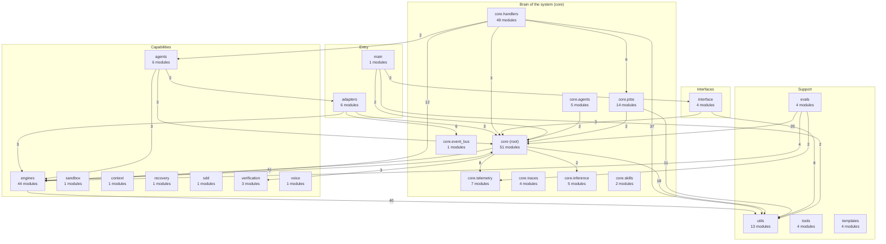

### 1.2 Processes, ports and data stores

Flexie runs as several cooperating processes that talk over localhost sockets. Ports and files below are the defaults in `utils/config.py`, `utils/udp_auth.py` and `main.py`.

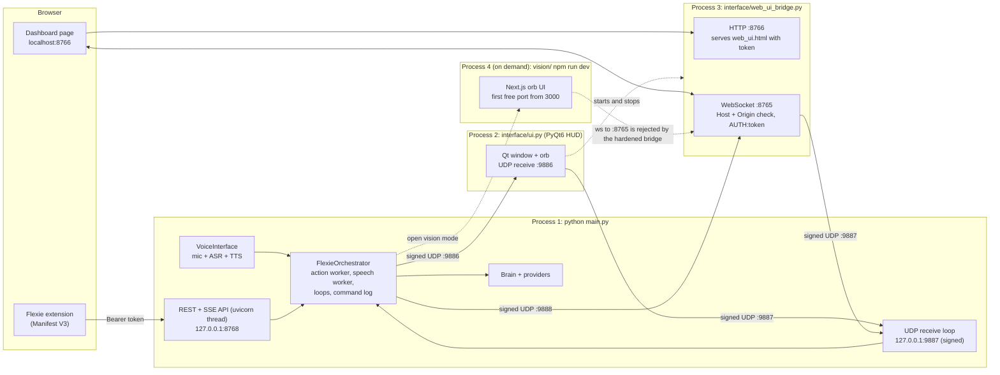

```mermaid
flowchart TB
    subgraph DB["SQLite databases (shared WAL connection per file)"]
        D1["data/telemetry.db<br/>LLM calls: tokens, cost, latency, failures"]
        D2["data/traces.db<br/>command traces and steps"]
        D3["data/memory_structured.db<br/>MemoryManager entries"]
        D4["flexie_memory.db, flexie_awareness.db,<br/>flexie_global_profile.db, clipboard_history.db"]
    end
    subgraph FILES["Files and folders"]
        F1["context/flexie_memory/<br/>Chroma vector store"]
        F2["workspace/.flexie_jobs/*.json<br/>build job state"]
        F3["flexie_activity.log, flexie_telemetry.log<br/>rotating logs"]
        F4[".flexie_udp_token, .flexie_ui_ports<br/>per-run auth and UI subscribers"]
        F5["browser_session/<br/>Playwright profile"]
        F6["automation_jobs.json, knowledge_index.json<br/>scheduler jobs, file index"]
        F7["Downloads/ job project folders<br/>Downloads/Flexie Images/"]
    end
    BRAINX["Brain + telemetry"] --> D1
    TRACEX["TraceCollector"] --> D2
    MEMX["MemoryManager / MemoryFacade"] --> D3
    ENGX["Memory, awareness, profile, clipboard engines"] --> D4
    VSX["VectorStore"] --> F1
    JOBX["JobManager"] --> F2
    LOGX["logging"] --> F3
    MAINX["main.py + udp_auth"] --> F4
    BRW["BrowserEngine"] --> F5
    SCHED["AutomationScheduler + KnowledgeEngine"] --> F6
    GENX["Build jobs + image downloader"] --> F7
```

## 2. Runtime flows


### 2.1 Startup (`main.py`)

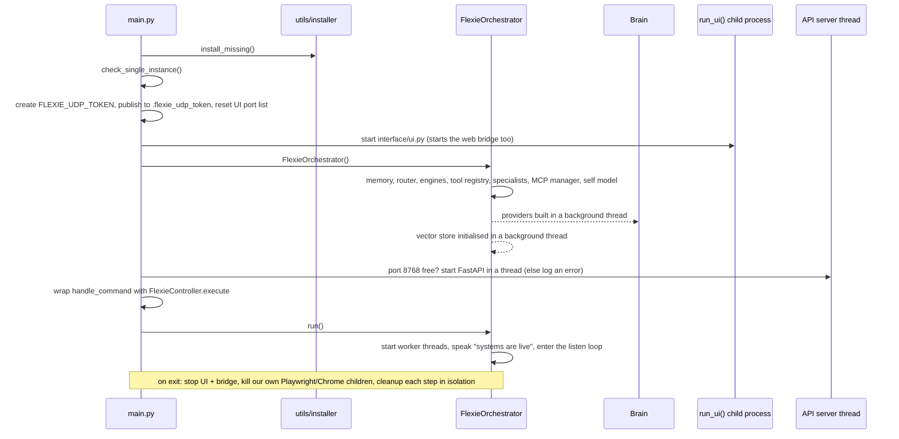

### 2.2 Threads and queues inside the orchestrator

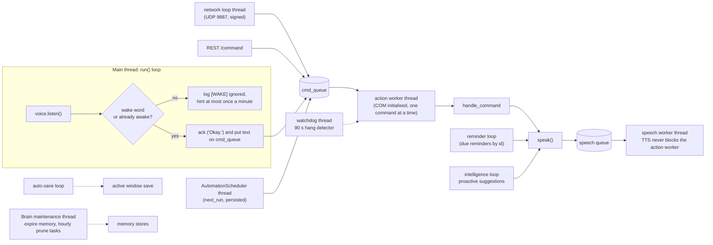

### 2.3 `handle_command` in detail

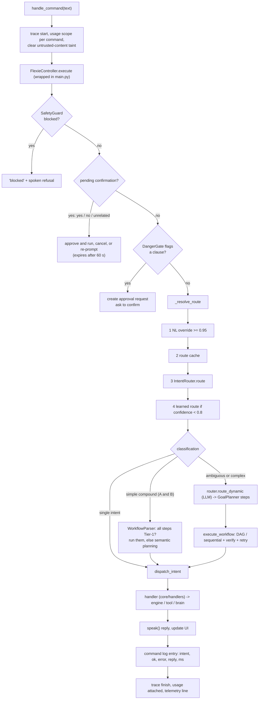

### 2.4 Voice in and out

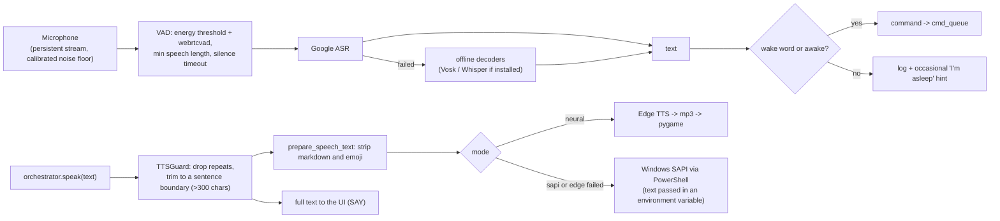

### 2.5 Tool execution and permissions

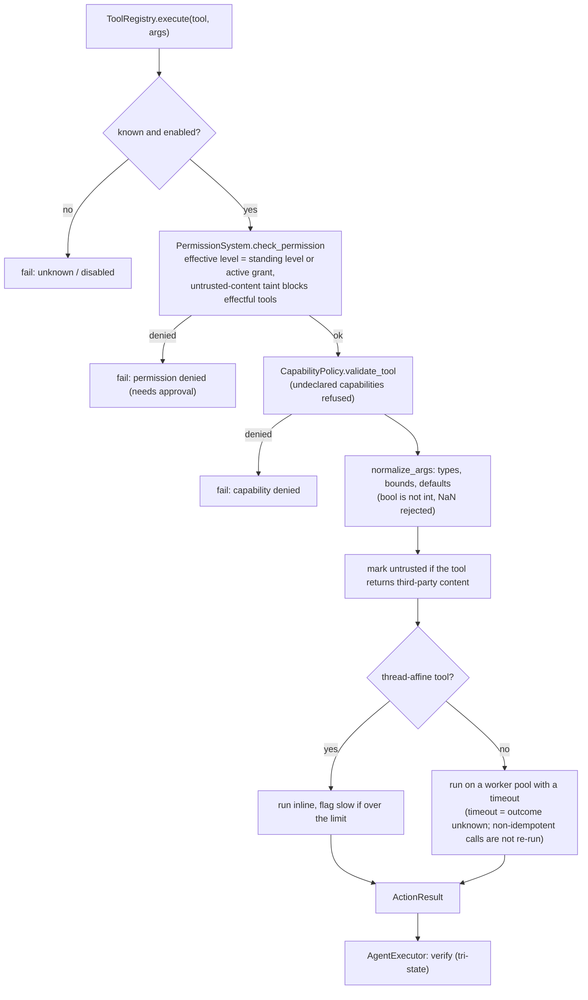

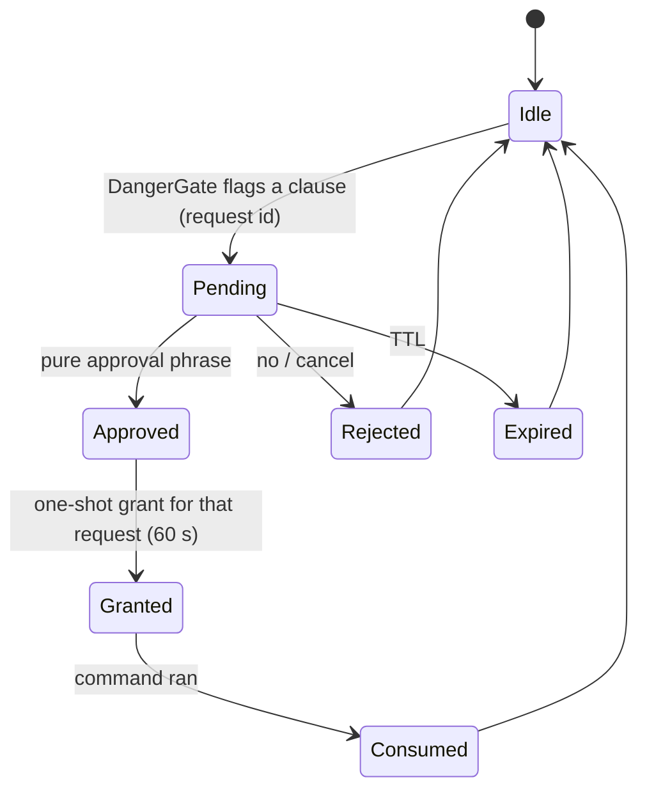

### 2.6 `Brain.ask`

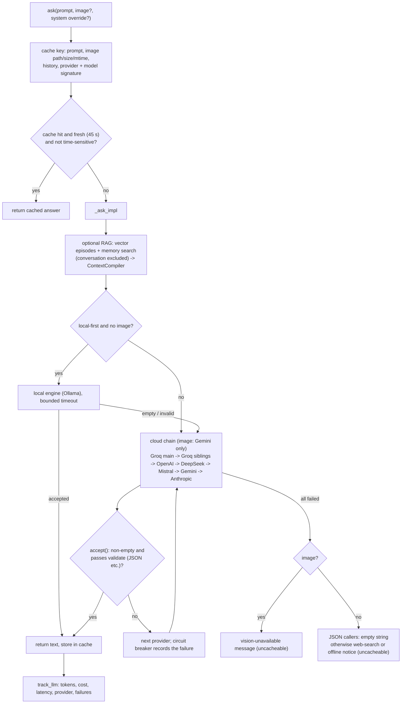

### 2.7 Memory: remember, recall, forget

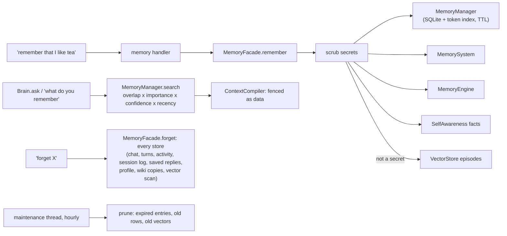

### 2.8 Autonomous build job

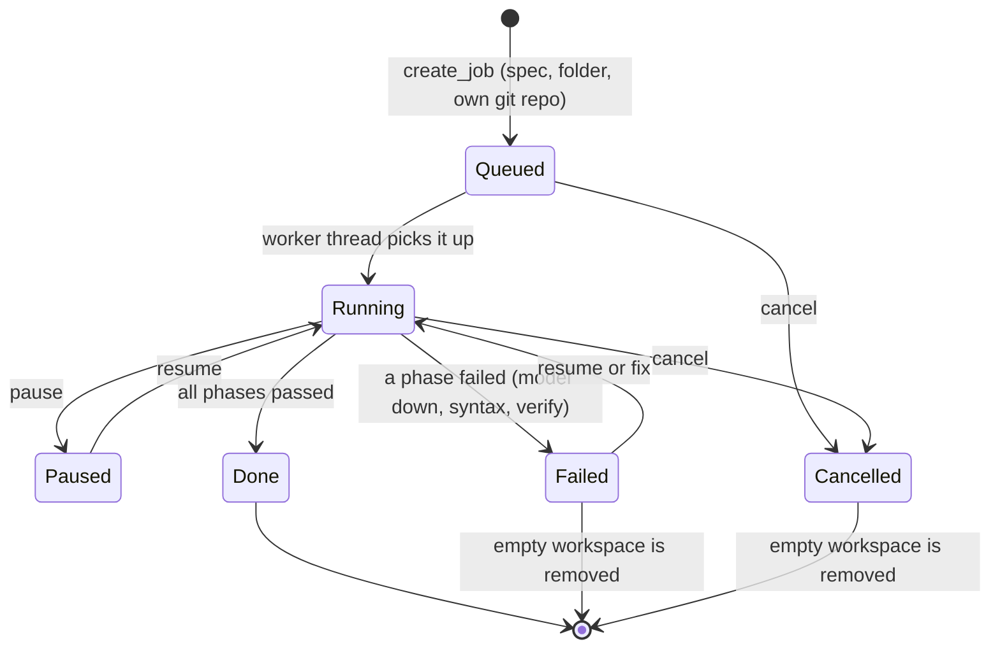

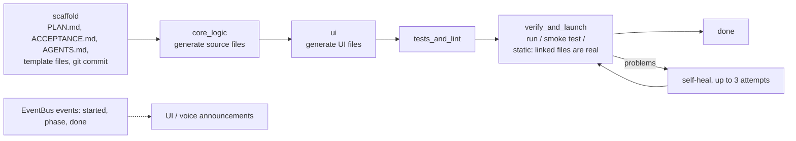

### 2.9 MCP servers

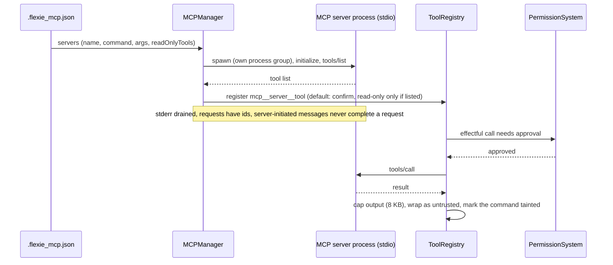

### 2.10 Planning and specialists

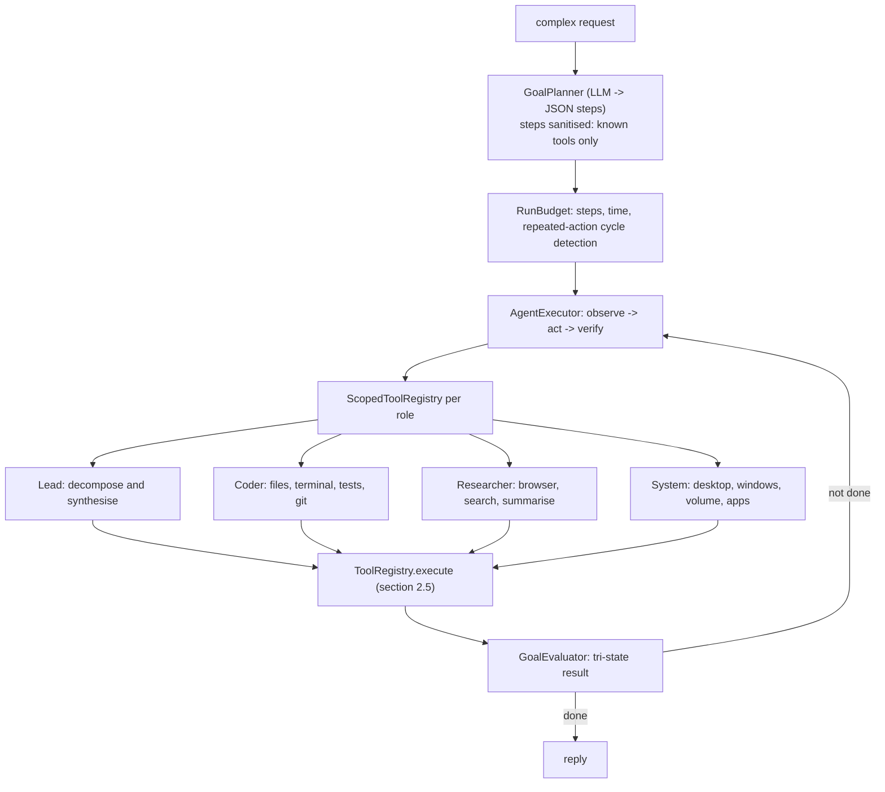

### 2.11 REST API and browser extension

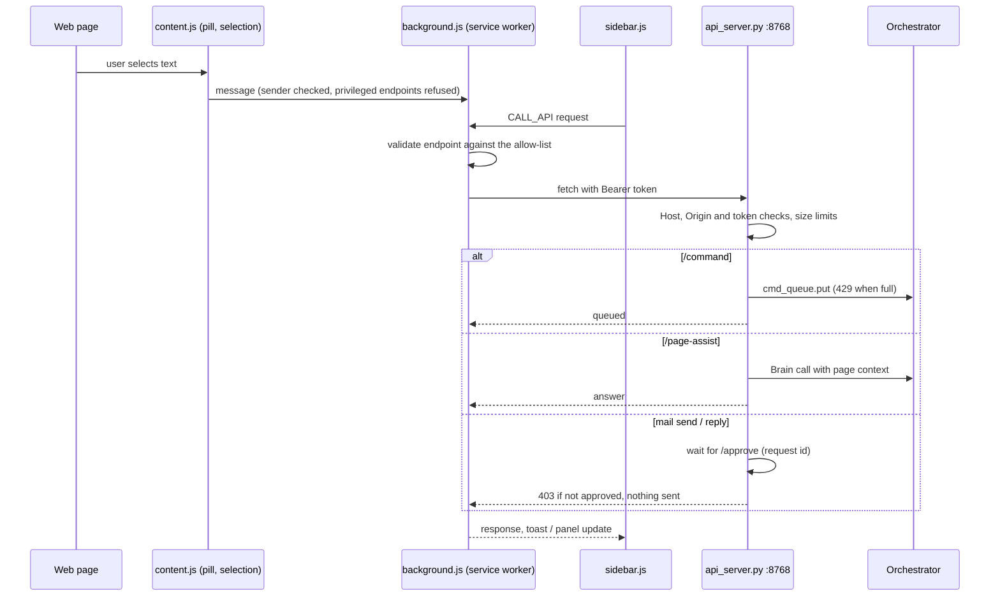

### 2.12 Telemetry, traces and events

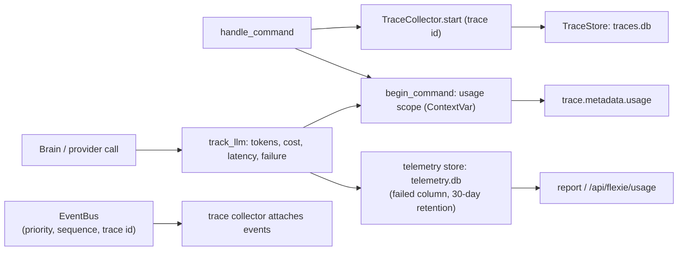

### 2.13 Screen, images and vision mode

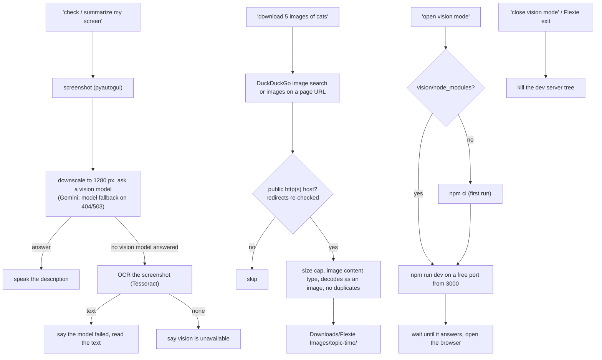

### 2.14 Tests, evals and CI

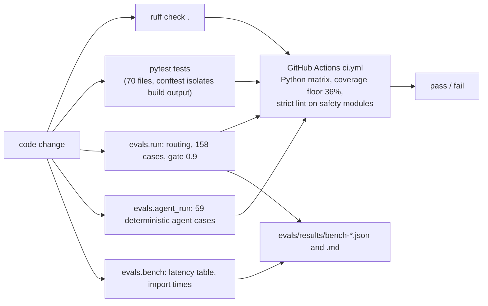

## 3. Module diagrams per folder

Arrows point from the importing module to the imported one. Lazy imports inside functions count.

### 3.1 `core/` (root modules by area)

```mermaid
flowchart LR
    subgraph sg0["Safety and control"]
        n_core_controller["<b>controller.py</b><br/>FlexieController: safety front door (SafetyGuard, DangerGate, approval"]
        n_core_danger_gate["<b>danger_gate.py</b><br/>DangerGate: per-clause risky-intent detection and confirmation words"]
        n_core_safety["<b>safety.py</b><br/>SafetyGuard: NFKC-normalised command blocklist and restricted-word fil"]
        n_core_permission_system["<b>permission_system.py</b><br/>Permission System — centralizes all permission checks for tool executi"]
        n_core_plan_text["<b>plan_text.py</b><br/>Clause splitting for multi-step requests."]
        n_core_run_budget["<b>run_budget.py</b><br/>Run budget + loop guard for autonomous plan execution."]
        n_core_capabilities["<b>capabilities.py</b><br/>Capability vocabulary and policy for tools and skills."]
        n_core_capability_provider["<b>capability_provider.py</b><br/>PluginDiscovery: opt-in plugin loader (allow-listed, by file path)"]
        n_core_capability_registry["<b>capability_registry.py</b><br/>Capability + CapabilityRegistry: intent -&gt; capability ownership"]
    end
    subgraph sg1["Routing and planning"]
        n_core_router["<b>router.py</b><br/>IntentRouter: typo fix, NL overrides, compiled triggers -&gt; intent +"]
        n_core_hybrid_router["<b>hybrid_router.py</b><br/>Hybrid Router — smart escalation between deterministic routing and age"]
        n_core_adaptive_router["<b>adaptive_router.py</b><br/>learns routes from outcomes, advisory only (never full confidence)"]
        n_core_task_classifier["<b>task_classifier.py</b><br/>TaskType / TaskState / TaskClassifier"]
        n_core_workflow_gatekeeper["<b>workflow_gatekeeper.py</b><br/>classifies a command as deterministic or needing planning"]
        n_core_workflow_parser["<b>workflow_parser.py</b><br/>WorkflowParser: splits 'A and B then C' into steps"]
        n_core_goal_planner["<b>goal_planner.py</b><br/>Goal Planner — decomposes natural-language goals into structured task "]
        n_core_goal_evaluator["<b>goal_evaluator.py</b><br/>Goal Completion Evaluator — verifies that the original user goal was a"]
        n_core_dag_planner["<b>dag_planner.py</b><br/>DAGPlanner: runs independent steps in parallel (4 threads)"]
        n_core_workflow_executor["<b>workflow_executor.py</b><br/>WorkflowExecutor: sequential steps + verify + retry"]
        n_core_execution_graph["<b>execution_graph.py</b><br/>ExecutionGraph: nodes/edges of what ran in a workflow"]
        n_core_task_critic["<b>task_critic.py</b><br/>TaskCritic: scores a finished step"]
        n_core_agent_arbitrator["<b>agent_arbitrator.py</b><br/>picks which agent handles a task"]
    end
    subgraph sg2["Execution and tools"]
        n_core_tool_registry["<b>tool_registry.py</b><br/>Tool Abstraction Layer — centralizes all tool registration, validation"]
        n_core_agent_executor["<b>agent_executor.py</b><br/>Agent Executor — runs the Observe → Act → Verify loop for tool executi"]
        n_core_agent_loop["<b>agent_loop.py</b><br/>ReAct Agent Loop — LangGraph-based agentic planning and tool execution"]
        n_core_atomic_actions["<b>atomic_actions.py</b><br/>Registry for all Atomic Actions that must execute directly"]
        n_core_action_command["<b>action_command.py</b><br/>ActionCommand — Structured internal command representation."]
        n_core_action_result["<b>action_result.py</b><br/>ActionResult — Structured return type for all Flexie action handlers."]
        n_core_coding_tools["<b>coding_tools.py</b><br/>Coding Tools Registry — registers autonomous coding tools into ToolReg"]
        n_core_browser_and_comm_tools["<b>browser_and_comm_tools.py</b><br/>Browser & Communication Tools Registry."]
        n_core_desktop_control["<b>desktop_control.py</b><br/>Desktop Control — safe abstraction for general desktop interaction."]
        n_core_mcp_adapter["<b>mcp_adapter.py</b><br/>Model Context Protocol (MCP) Client Adapter."]
        n_core_specialists["<b>specialists.py</b><br/>Specialist Agents — scoped, tool-using agents with delegation."]
    end
    subgraph sg3["LLM and self"]
        n_core_brain["<b>brain.py</b><br/>Brain: LLM provider chain, cache, circuit breaker, streaming, maintena"]
        n_core_llm_providers["<b>llm_providers.py</b><br/>LLM Provider Configuration — centralized, no hardcoded model names."]
        n_core_llm_failure["<b>llm_failure.py</b><br/>Recognise text that is a *failure message*, not a real model answer."]
        n_core_model_hub["<b>model_hub.py</b><br/>Model Hub: task-based routing, cheap-first cascade, resilience, and Op"]
        n_core_persona["<b>persona.py</b><br/>Persistent persona loader."]
        n_core_self_model["<b>self_model.py</b><br/>Flexie's live model of itself."]
    end
    subgraph sg4["Memory"]
        n_core_memory_manager["<b>memory_manager.py</b><br/>Memory Manager — structured memory with clear categories."]
        n_core_memory_facade["<b>memory_facade.py</b><br/>Single write/forget path for user facts across every memory store."]
        n_core_vector_store["<b>vector_store.py</b><br/>VectorStore: Chroma episodes, background init, prune"]
        n_core_context_memory["<b>context_memory.py</b><br/>short-term conversational context (last file, app, pending action with"]
    end
    n_core_controller --> n_core_danger_gate
    n_core_controller --> n_core_safety
    n_core_controller --> n_core_tool_registry
    n_core_danger_gate --> n_core_plan_text
    n_core_permission_system --> n_core_danger_gate
    n_core_permission_system --> n_core_tool_registry
    n_core_capability_provider --> n_core_capability_registry
    n_core_router --> n_core_self_model
    n_core_hybrid_router --> n_core_context_memory
    n_core_hybrid_router --> n_core_permission_system
    n_core_hybrid_router --> n_core_router
    n_core_hybrid_router --> n_core_tool_registry
    n_core_goal_planner --> n_core_action_result
    n_core_goal_planner --> n_core_plan_text
    n_core_dag_planner --> n_core_action_result
    n_core_workflow_executor --> n_core_action_result
    n_core_workflow_executor --> n_core_execution_graph
    n_core_workflow_executor --> n_core_goal_evaluator
    n_core_workflow_executor --> n_core_run_budget
    n_core_workflow_executor --> n_core_task_classifier
    n_core_tool_registry --> n_core_action_result
    n_core_tool_registry --> n_core_capabilities
    n_core_agent_executor --> n_core_action_result
    n_core_agent_executor --> n_core_execution_graph
    n_core_agent_executor --> n_core_goal_planner
    n_core_agent_executor --> n_core_permission_system
    n_core_agent_executor --> n_core_run_budget
    n_core_agent_executor --> n_core_tool_registry
    n_core_coding_tools --> n_core_action_result
    n_core_coding_tools --> n_core_memory_manager
    n_core_coding_tools --> n_core_safety
    n_core_coding_tools --> n_core_tool_registry
    n_core_browser_and_comm_tools --> n_core_action_result
    n_core_browser_and_comm_tools --> n_core_tool_registry
    n_core_desktop_control --> n_core_action_result
    n_core_desktop_control --> n_core_permission_system
    n_core_desktop_control --> n_core_tool_registry
    n_core_mcp_adapter --> n_core_action_result
    n_core_mcp_adapter --> n_core_tool_registry
    n_core_specialists --> n_core_action_result
    n_core_specialists --> n_core_tool_registry
    n_core_brain --> n_core_agent_loop
    n_core_brain --> n_core_llm_failure
    n_core_brain --> n_core_llm_providers
    n_core_brain --> n_core_memory_manager
    n_core_brain --> n_core_persona
    n_core_brain --> n_core_vector_store
    n_core_self_model --> n_core_memory_manager
    n_core_memory_facade --> n_core_memory_manager
    n_core_vector_store --> n_core_memory_manager
```

Remaining `core/` root modules:

```mermaid
flowchart LR
    n_core_agents["<b>agents.py</b><br/>agent package"]
    n_core_handlers["<b>handlers.py</b><br/>handler package"]
    n_core_inference["<b>inference.py</b><br/>inference engine package"]
    n_core_jobs["<b>jobs.py</b><br/>Background Build Job Runner package for autonomous project creation."]
    n_core_skills["<b>skills.py</b><br/>skills package"]
    n_core_telemetry["<b>telemetry.py</b><br/>telemetry package"]
    n_core_traces["<b>traces.py</b><br/>traces package"]
```

### 3.2 `core/orchestrator.py` — what it wires together

```mermaid
flowchart LR
    n_core_orchestrator["<b>core/orchestrator.py</b><br/>owns every subsystem"]
    subgraph w0["core (root)"]
        n_core_action_result["action_result.py"]
        n_core_adaptive_router["adaptive_router.py"]
        n_core_agent_arbitrator["agent_arbitrator.py"]
        n_core_agent_executor["agent_executor.py"]
        n_core_brain["brain.py"]
        n_core_browser_and_comm_tools["browser_and_comm_tools.py"]
        n_core_capability_provider["capability_provider.py"]
        n_core_capability_registry["capability_registry.py"]
        n_core_coding_tools["coding_tools.py"]
        n_core_context_memory["context_memory.py"]
        n_core_dag_planner["dag_planner.py"]
        n_core_desktop_control["desktop_control.py"]
        n_core_execution_graph["execution_graph.py"]
        n_core_goal_planner["goal_planner.py"]
        n_core_handlers["handlers.py"]
        n_core_hybrid_router["hybrid_router.py"]
        n_core_mcp_adapter["mcp_adapter.py"]
        n_core_memory_facade["memory_facade.py"]
        n_core_memory_manager["memory_manager.py"]
        n_core_permission_system["permission_system.py"]
        n_core_router["router.py"]
        n_core_safety["safety.py"]
        n_core_self_model["self_model.py"]
        n_core_specialists["specialists.py"]
        n_core_task_classifier["task_classifier.py"]
        n_core_task_critic["task_critic.py"]
        n_core_tool_registry["tool_registry.py"]
        n_core_traces["traces.py"]
        n_core_workflow_executor["workflow_executor.py"]
        n_core_workflow_gatekeeper["workflow_gatekeeper.py"]
        n_core_workflow_parser["workflow_parser.py"]
    end
    n_core_orchestrator --> w0
    subgraph w1["core.jobs"]
        n_core_jobs_handler["handler.py"]
    end
    n_core_orchestrator --> w1
    subgraph w2["core.telemetry"]
        n_core_telemetry_usage["usage.py"]
    end
    n_core_orchestrator --> w2
    subgraph w3["engines"]
        n_engines_age_calc["age_calc.py"]
        n_engines_alarm["alarm.py"]
        n_engines_automation["automation.py"]
        n_engines_body_metrics["body_metrics.py"]
        n_engines_browser["browser.py"]
        n_engines_clipboard_mgr["clipboard_mgr.py"]
        n_engines_color_info["color_info.py"]
        n_engines_developer["developer.py"]
        n_engines_dictionary["dictionary.py"]
        n_engines_email_engine["email_engine.py"]
        n_engines_facts["facts.py"]
        n_engines_files["files.py"]
        n_engines_hash_encoder["hash_encoder.py"]
        n_engines_image_gen["image_gen.py"]
        n_engines_intelligence["intelligence.py"]
        n_engines_ip_lookup["ip_lookup.py"]
        n_engines_jokes["jokes.py"]
        n_engines_json_formatter["json_formatter.py"]
        n_engines_knowledge["knowledge.py"]
        n_engines_lorem["lorem.py"]
        n_engines_memory["memory.py"]
        n_engines_memory_system["memory_system.py"]
        n_engines_music["music.py"]
        n_engines_news["news.py"]
        n_engines_password_gen["password_gen.py"]
        n_engines_pdf_reader["pdf_reader.py"]
        n_engines_pomodoro["pomodoro.py"]
        n_engines_qrcode_gen["qrcode_gen.py"]
        n_engines_quotes["quotes.py"]
        n_engines_self_awareness["self_awareness.py"]
        n_engines_system["system.py"]
        n_engines_text_summarizer["text_summarizer.py"]
        n_engines_text_tools["text_tools.py"]
        n_engines_tip_calc["tip_calc.py"]
        n_engines_uuid_gen["uuid_gen.py"]
        n_engines_vision["vision.py"]
        n_engines_vision_mode["vision_mode.py"]
        n_engines_weather["weather.py"]
        n_engines_wiki["wiki.py"]
        n_engines_youtube_controller["youtube_controller.py"]
    end
    n_core_orchestrator --> w3
    subgraph w4["interface"]
        n_interface_voice["voice.py"]
    end
    n_core_orchestrator --> w4
    subgraph w5["utils"]
        n_utils_config["config.py"]
        n_utils_helpers["helpers.py"]
        n_utils_udp_auth["udp_auth.py"]
    end
    n_core_orchestrator --> w5
    subgraph w6["verification"]
        n_verification_capability_validator["capability_validator.py"]
        n_verification_semantic_validator["semantic_validator.py"]
        n_verification_strict_validator["strict_validator.py"]
    end
    n_core_orchestrator --> w6
    subgraph w7["voice"]
        n_voice_tts_guard["tts_guard.py"]
    end
    n_core_orchestrator --> w7
```

### 3.3 `core/handlers/` — intent to handler to engine

The dispatcher picks a handler by intent; handlers receive the orchestrator and call its engines. Mapping below comes from the command table in the README (only files that exist).

```mermaid
flowchart LR
    D["dispatch_intent<br/>core/handlers/dispatcher.py"]
    D --> i_undo(["undo"])
    i_undo --> h_system["handlers/system.py"]
    D --> i_voice_macro(["voice_macro"])
    i_voice_macro --> h_system["handlers/system.py"]
    D --> i_daily_briefing(["daily_briefing"])
    i_daily_briefing --> h_dev["handlers/dev.py"]
    D --> i_meeting_mode(["meeting_mode"])
    i_meeting_mode --> h_system["handlers/system.py"]
    D --> i_dictation_mode(["dictation_mode"])
    i_dictation_mode --> h_system["handlers/system.py"]
    D --> i_exit(["exit"])
    i_exit --> h_system["handlers/system.py"]
    D --> i_browser_control(["browser_control"])
    i_browser_control --> h_browser["handlers/browser.py"]
    h_browser --> e_browser["engines/browser.py"]
    D --> i_browser_tabs(["browser_tabs"])
    i_browser_tabs --> h_browser["handlers/browser.py"]
    D --> i_browser_extract(["browser_extract"])
    i_browser_extract --> h_browser["handlers/browser.py"]
    D --> i_play_youtube(["play_youtube"])
    i_play_youtube --> h_media["handlers/media.py"]
    h_media --> e_browser["engines/browser.py"]
    D --> i_gmail(["gmail"])
    i_gmail --> h_browser["handlers/browser.py"]
    h_browser --> e_email_engine["engines/email_engine.py"]
    D --> i_github(["github"])
    i_github --> h_browser["handlers/browser.py"]
    D --> i_mode(["mode"])
    i_mode --> h_system["handlers/system.py"]
    D --> i_power(["power"])
    i_power --> h_system["handlers/system.py"]
    h_system --> e_system["engines/system.py"]
    D --> i_browser_navigate(["browser_navigate"])
    i_browser_navigate --> h_browser["handlers/browser.py"]
    D --> i_youtube(["youtube"])
    i_youtube --> h_media["handlers/media.py"]
    D --> i_browser_search(["browser_search"])
    i_browser_search --> h_search["handlers/search.py"]
    D --> i_multi_tab_research(["multi_tab_research"])
    i_multi_tab_research --> h_browser["handlers/browser.py"]
    D --> i_remind_me(["remind_me"])
    i_remind_me --> h_reminders["handlers/reminders.py"]
    D --> i_list_reminders(["list_reminders"])
    i_list_reminders --> h_reminders["handlers/reminders.py"]
    D --> i_media(["media"])
    i_media --> h_system["handlers/system.py"]
    D --> i_app_op(["app_op"])
    i_app_op --> h_system["handlers/system.py"]
    h_system --> e_files["engines/files.py"]
    D --> i_vision_analyze(["vision_analyze"])
    i_vision_analyze --> h_vision["handlers/vision.py"]
    h_vision --> e_vision["engines/vision.py"]
    D --> i_vision_debug(["vision_debug"])
    i_vision_debug --> e_developer["engines/developer.py"]
    D --> i_vision_read(["vision_read"])
    i_vision_read --> h_vision["handlers/vision.py"]
    D --> i_vision_capture(["vision_capture"])
    i_vision_capture --> h_vision["handlers/vision.py"]
    D --> i_camera_capture(["camera_capture"])
    i_camera_capture --> h_vision["handlers/vision.py"]
    D --> i_vision_show(["vision_show"])
    i_vision_show --> h_vision["handlers/vision.py"]
    D --> i_vision_manage(["vision_manage"])
    i_vision_manage --> h_vision["handlers/vision.py"]
    D --> i_dev_explain(["dev_explain"])
    i_dev_explain --> e_developer["engines/developer.py"]
    D --> i_repo_analyzer(["repo_analyzer"])
    i_repo_analyzer --> e_developer["engines/developer.py"]
    D --> i_project_explainer(["project_explainer"])
    i_project_explainer --> e_developer["engines/developer.py"]
    D --> i_bug_hunter(["bug_hunter"])
    i_bug_hunter --> e_developer["engines/developer.py"]
    D --> i_test_generator(["test_generator"])
    i_test_generator --> e_developer["engines/developer.py"]
    D --> i_sdd_build(["sdd_build"])
    i_sdd_build --> e_developer["engines/developer.py"]
    D --> i_file_rename(["file_rename"])
    i_file_rename --> h_files["handlers/files.py"]
    D --> i_file_delete(["file_delete"])
    i_file_delete --> h_files["handlers/files.py"]
    D --> i_file_save(["file_save"])
    i_file_save --> h_files["handlers/files.py"]
    D --> i_file_op(["file_op"])
    i_file_op --> h_files["handlers/files.py"]
    D --> i_knowledge_search(["knowledge_search"])
    i_knowledge_search --> h_files["handlers/files.py"]
    h_files --> e_knowledge["engines/knowledge.py"]
    D --> i_intel(["intel"])
    i_intel --> h_dev["handlers/dev.py"]
    D --> i_briefing(["briefing"])
    i_briefing --> h_dev["handlers/dev.py"]
    D --> i_clipboard(["clipboard"])
    i_clipboard --> h_dev["handlers/dev.py"]
    D --> i_auto_save(["auto_save"])
    i_auto_save --> h_system["handlers/system.py"]
    D --> i_save_active(["save_active"])
    i_save_active --> h_system["handlers/system.py"]
    D --> i_dev_build(["dev_build"])
    i_dev_build --> e_developer["engines/developer.py"]
    D --> i_dev(["dev"])
    i_dev --> e_developer["engines/developer.py"]
    D --> i_comm(["comm"])
    i_comm --> h_system["handlers/system.py"]
    D --> i_voice(["voice"])
    i_voice --> h_system["handlers/system.py"]
    D --> i_social(["social"])
    i_social --> h_dispatcher["handlers/dispatcher.py"]
    D --> i_search(["search"])
    i_search --> h_search["handlers/search.py"]
    D --> i_calc(["calc"])
    i_calc --> h_tools["handlers/tools.py"]
    D --> i_convert(["convert"])
    i_convert --> h_converter["handlers/converter.py"]
    D --> i_translate(["translate"])
    i_translate --> h_tools["handlers/tools.py"]
    D --> i_status(["status"])
    i_status --> h_tools["handlers/tools.py"]
    D --> i_memory(["memory"])
    i_memory --> h_tools["handlers/tools.py"]
    h_tools --> e_memory["engines/memory.py"]
    D --> i_weather(["weather"])
    i_weather --> h_weather["handlers/weather.py"]
    h_weather --> e_weather["engines/weather.py"]
    D --> i_image_gen(["image_gen"])
    i_image_gen --> h_image_gen["handlers/image_gen.py"]
    h_image_gen --> e_image_gen["engines/image_gen.py"]
    D --> i_news(["news"])
    i_news --> h_news["handlers/news.py"]
    h_news --> e_news["engines/news.py"]
    D --> i_alarm(["alarm"])
    i_alarm --> h_alarm["handlers/alarm.py"]
    h_alarm --> e_alarm["engines/alarm.py"]
```

Imports between handler modules and the rest of the system:

```mermaid
flowchart LR
    n_core_handlers_age["age.py"]
    n_core_handlers_agents["agents.py"]
    n_core_handlers_alarm["alarm.py"]
    n_core_handlers_automation["automation.py"]
    n_core_handlers_awareness["awareness.py"]
    n_core_handlers_body_metrics["body_metrics.py"]
    n_core_handlers_browser["browser.py"]
    n_core_handlers_clipboard_mgr["clipboard_mgr.py"]
    n_core_handlers_code_gen["code_gen.py"]
    n_core_handlers_code_search["code_search.py"]
    n_core_handlers_color_info["color_info.py"]
    n_core_handlers_context["context.py"]
    n_core_handlers_converter["converter.py"]
    n_core_handlers_dev["dev.py"]
    n_core_handlers_dictionary["dictionary.py"]
    n_core_handlers_dispatcher["dispatcher.py"]
    n_core_handlers_facts["facts.py"]
    n_core_handlers_files["files.py"]
    n_core_handlers_hash_encoder["hash_encoder.py"]
    n_core_handlers_image_gen["image_gen.py"]
    n_core_handlers_images["images.py"]
    n_core_handlers_ip_lookup["ip_lookup.py"]
    n_core_handlers_jokes["jokes.py"]
    n_core_handlers_json_fmt["json_fmt.py"]
    n_core_handlers_lorem["lorem.py"]
    n_core_handlers_mail["mail.py"]
    n_core_handlers_media["media.py"]
    n_core_handlers_memory_system["memory_system.py"]
    n_core_handlers_news["news.py"]
    n_core_handlers_notification["notification.py"]
    n_core_handlers_password["password.py"]
    n_core_handlers_pdf["pdf.py"]
    n_core_handlers_pomodoro["pomodoro.py"]
    n_core_handlers_qrcode["qrcode.py"]
    n_core_handlers_quotes["quotes.py"]
    n_core_handlers_reminders["reminders.py"]
    n_core_handlers_research["research.py"]
    n_core_handlers_search["search.py"]
    n_core_handlers_summarize["summarize.py"]
    n_core_handlers_system["system.py"]
    n_core_handlers_text_tools["text_tools.py"]
    n_core_handlers_tip["tip.py"]
    n_core_handlers_todo["todo.py"]
    n_core_handlers_tools["tools.py"]
    n_core_handlers_uuid["uuid.py"]
    n_core_handlers_vision["vision.py"]
    n_core_handlers_vision_mode["vision_mode.py"]
    n_core_handlers_weather["weather.py"]
    n_core_handlers_wiki["wiki.py"]
    n_core_handlers_context --> n_core_handlers_code_gen
    n_core_handlers_dispatcher --> n_core_handlers_age
    n_core_handlers_dispatcher --> n_core_handlers_agents
    n_core_handlers_dispatcher --> n_core_handlers_alarm
    n_core_handlers_dispatcher --> n_core_handlers_automation
    n_core_handlers_dispatcher --> n_core_handlers_awareness
    n_core_handlers_dispatcher --> n_core_handlers_body_metrics
    n_core_handlers_dispatcher --> n_core_handlers_browser
    n_core_handlers_dispatcher --> n_core_handlers_clipboard_mgr
    n_core_handlers_dispatcher --> n_core_handlers_code_gen
    n_core_handlers_dispatcher --> n_core_handlers_code_search
    n_core_handlers_dispatcher --> n_core_handlers_color_info
    n_core_handlers_dispatcher --> n_core_handlers_converter
    n_core_handlers_dispatcher --> n_core_handlers_dev
    n_core_handlers_dispatcher --> n_core_handlers_dictionary
    n_core_handlers_dispatcher --> n_core_handlers_facts
    n_core_handlers_dispatcher --> n_core_handlers_files
    n_core_handlers_dispatcher --> n_core_handlers_hash_encoder
    n_core_handlers_dispatcher --> n_core_handlers_image_gen
    n_core_handlers_dispatcher --> n_core_handlers_images
    n_core_handlers_dispatcher --> n_core_handlers_ip_lookup
    n_core_handlers_dispatcher --> n_core_handlers_jokes
    n_core_handlers_dispatcher --> n_core_handlers_json_fmt
    n_core_handlers_dispatcher --> n_core_handlers_lorem
    n_core_handlers_dispatcher --> n_core_handlers_mail
    n_core_handlers_dispatcher --> n_core_handlers_media
    n_core_handlers_dispatcher --> n_core_handlers_memory_system
    n_core_handlers_dispatcher --> n_core_handlers_news
    n_core_handlers_dispatcher --> n_core_handlers_notification
    n_core_handlers_dispatcher --> n_core_handlers_password
    n_core_handlers_dispatcher --> n_core_handlers_pdf
    n_core_handlers_dispatcher --> n_core_handlers_pomodoro
    n_core_handlers_dispatcher --> n_core_handlers_qrcode
    n_core_handlers_dispatcher --> n_core_handlers_quotes
    n_core_handlers_dispatcher --> n_core_handlers_reminders
    n_core_handlers_dispatcher --> n_core_handlers_research
    n_core_handlers_dispatcher --> n_core_handlers_search
    n_core_handlers_dispatcher --> n_core_handlers_summarize
    n_core_handlers_dispatcher --> n_core_handlers_system
    n_core_handlers_dispatcher --> n_core_handlers_text_tools
    n_core_handlers_dispatcher --> n_core_handlers_tip
    n_core_handlers_dispatcher --> n_core_handlers_todo
    n_core_handlers_dispatcher --> n_core_handlers_tools
    n_core_handlers_dispatcher --> n_core_handlers_uuid
    n_core_handlers_dispatcher --> n_core_handlers_vision
    n_core_handlers_dispatcher --> n_core_handlers_vision_mode
    n_core_handlers_dispatcher --> n_core_handlers_weather
    n_core_handlers_dispatcher --> n_core_handlers_wiki
    n_core_handlers_pdf --> n_core_handlers_summarize
    n_core_handlers_summarize --> n_core_handlers_mail
    n_core_handlers_tools --> n_core_handlers_memory_system
```

### 3.4 `core/jobs/` — autonomous build jobs

```mermaid
flowchart LR
    n_core_jobs_generator["<b>generator.py</b><br/>Code Generation Engine for Build Jobs."]
    n_core_jobs_git_ops["<b>git_ops.py</b><br/>Git versioning and phase undo operations inside job workspaces."]
    n_core_jobs_handler["<b>handler.py</b><br/>Clean orchestrator handler bridge for background build jobs."]
    n_core_jobs_launcher["<b>launcher.py</b><br/>Desktop and IDE launcher for background build jobs."]
    n_core_jobs_lessons["<b>lessons.py</b><br/>Bounded, per-project, sanitized store for 'lessons learned' notes."]
    n_core_jobs_manager["<b>manager.py</b><br/>JobManager: background execution, queueing, state persistence, and eve"]
    n_core_jobs_models["<b>models.py</b><br/>Data models for Build Jobs."]
    n_core_jobs_planner["<b>planner.py</b><br/>Planning & Specification Engine for autonomous Dev Assistant projects."]
    n_core_jobs_process["<b>process.py</b><br/>Process tree management, scrubbed environments and cancellable subproc"]
    n_core_jobs_safe_paths["<b>safe_paths.py</b><br/>Shared path-safety helpers for the build-job subsystem."]
    n_core_jobs_scaffold["<b>scaffold.py</b><br/>Scaffolding engine for Build Jobs."]
    n_core_jobs_slugify["<b>slugify.py</b><br/>Safe workspace folder slugification for Windows and POSIX."]
    n_core_jobs_store["<b>store.py</b><br/>Atomic JSON persistence for Build Jobs."]
    n_core_jobs_verifier["<b>verifier.py</b><br/>Verification and Self-Healing Engine for Build Jobs."]
    n_core_jobs_generator --> n_core_jobs_lessons
    n_core_jobs_generator --> n_core_jobs_models
    n_core_jobs_generator --> n_core_jobs_planner
    n_core_jobs_generator --> n_core_jobs_safe_paths
    n_core_jobs_git_ops --> n_core_jobs_process
    n_core_jobs_handler --> n_core_jobs_launcher
    n_core_jobs_handler --> n_core_jobs_manager
    n_core_jobs_handler --> n_core_jobs_models
    n_core_jobs_launcher --> n_core_jobs_models
    n_core_jobs_launcher --> n_core_jobs_process
    n_core_jobs_manager --> n_core_jobs_generator
    n_core_jobs_manager --> n_core_jobs_git_ops
    n_core_jobs_manager --> n_core_jobs_lessons
    n_core_jobs_manager --> n_core_jobs_models
    n_core_jobs_manager --> n_core_jobs_planner
    n_core_jobs_manager --> n_core_jobs_process
    n_core_jobs_manager --> n_core_jobs_safe_paths
    n_core_jobs_manager --> n_core_jobs_scaffold
    n_core_jobs_manager --> n_core_jobs_slugify
    n_core_jobs_manager --> n_core_jobs_store
    n_core_jobs_manager --> n_core_jobs_verifier
    n_core_jobs_planner --> n_core_jobs_safe_paths
    n_core_jobs_scaffold --> n_core_jobs_git_ops
    n_core_jobs_scaffold --> n_core_jobs_planner
    n_core_jobs_scaffold --> n_core_jobs_safe_paths
    n_core_jobs_store --> n_core_jobs_models
    n_core_jobs_verifier --> n_core_jobs_generator
    n_core_jobs_verifier --> n_core_jobs_planner
    n_core_jobs_verifier --> n_core_jobs_process
    n_core_jobs_verifier --> n_core_jobs_safe_paths
```

### 3.5 `core/telemetry/`

```mermaid
flowchart LR
    n_core_telemetry_legacy["<b>legacy.py</b><br/>Telemetry: per-command timing log (flexie_telemetry.log)"]
    n_core_telemetry_pricing["<b>pricing.py</b><br/>Token pricing for cost telemetry."]
    n_core_telemetry_record["<b>record.py</b><br/>Per-inference telemetry record."]
    n_core_telemetry_redact["<b>redact.py</b><br/>Light secret redaction for logs and persisted traces (best effort, reg"]
    n_core_telemetry_report["<b>report.py</b><br/>Print token / cost / latency telemetry from the persisted store."]
    n_core_telemetry_store["<b>store.py</b><br/>SQLite-backed telemetry store with basic aggregation."]
    n_core_telemetry_usage["<b>usage.py</b><br/>Per-call and per-command LLM usage telemetry (tokens, cost, latency)."]
    n_core_telemetry_report --> n_core_telemetry_store
    n_core_telemetry_store --> n_core_telemetry_record
    n_core_telemetry_usage --> n_core_telemetry_pricing
    n_core_telemetry_usage --> n_core_telemetry_record
    n_core_telemetry_usage --> n_core_telemetry_store
```

### 3.6 `core/traces/`

```mermaid
flowchart LR
    n_core_traces_analyzer["<b>analyzer.py</b><br/>Read-only aggregation over stored traces."]
    n_core_traces_collector["<b>collector.py</b><br/>Collect complete interaction traces and persist them."]
    n_core_traces_store["<b>store.py</b><br/>SQLite-backed trace store."]
    n_core_traces_trace["<b>trace.py</b><br/>Trace and TraceStep schemas."]
    n_core_traces_analyzer --> n_core_traces_store
    n_core_traces_collector --> n_core_traces_store
    n_core_traces_collector --> n_core_traces_trace
    n_core_traces_store --> n_core_traces_trace
```

### 3.7 `core/event_bus/`

```mermaid
flowchart LR
    n_core_event_bus_bus["<b>bus.py</b><br/>Event + EventBus: ordered pub/sub with trace ids"]
```

### 3.8 `core/inference/`

```mermaid
flowchart LR
    n_core_inference_base["<b>base.py</b><br/>Shared inference-engine contract."]
    n_core_inference_cloud["<b>cloud.py</b><br/>Adapter that exposes an existing callable as an InferenceEngine."]
    n_core_inference_hardware["<b>hardware.py</b><br/>Hardware-aware local model recommendation."]
    n_core_inference_ollama["<b>ollama.py</b><br/>Local Ollama engine using the native /api/chat endpoint."]
    n_core_inference_registry["<b>registry.py</b><br/>Registry of inference engines, with local-first resolution."]
    n_core_inference_cloud --> n_core_inference_base
    n_core_inference_ollama --> n_core_inference_base
    n_core_inference_registry --> n_core_inference_base
    n_core_inference_registry --> n_core_inference_ollama
```

### 3.9 `core/skills/`

```mermaid
flowchart LR
    n_core_skills_catalog["<b>catalog.py</b><br/>Render the available-skills catalog for a system prompt."]
    n_core_skills_loader["<b>loader.py</b><br/>Skill loading and catalog generation."]
    n_core_skills_catalog --> n_core_skills_loader
```

### 3.10 `core/agents/`

```mermaid
flowchart LR
    n_core_agents_base["<b>base.py</b><br/>Typed agent primitives shared by all Flexie agents."]
    n_core_agents_brain_generate["<b>brain_generate.py</b><br/>Adapter that gives a plain-text LLM (``Brain.ask``) a structured tool-"]
    n_core_agents_registry["<b>registry.py</b><br/>Agent registry keyed by agent id."]
    n_core_agents_scoped["<b>scoped.py</b><br/>A tool registry view that only exposes (and only executes) an allowlis"]
    n_core_agents_tool_using["<b>tool_using.py</b><br/>Multi-turn tool-calling agent loop."]
    n_core_agents_registry --> n_core_agents_base
    n_core_agents_tool_using --> n_core_agents_base
```

### 3.11 `engines/`

Each engine is a plain class owned by the orchestrator; most have no imports between them. Edges show where engines share code.

```mermaid
flowchart LR
    n_engines_age_calc["age_calc.py"]
    n_engines_alarm["alarm.py"]
    n_engines_automation["automation.py"]
    n_engines_body_metrics["body_metrics.py"]
    n_engines_browser["browser.py"]
    n_engines_clipboard_mgr["clipboard_mgr.py"]
    n_engines_code_search["code_search.py"]
    n_engines_color_info["color_info.py"]
    n_engines_developer["developer.py"]
    n_engines_dictionary["dictionary.py"]
    n_engines_email_engine["email_engine.py"]
    n_engines_facts["facts.py"]
    n_engines_files["files.py"]
    n_engines_hash_encoder["hash_encoder.py"]
    n_engines_image_downloader["image_downloader.py"]
    n_engines_image_gen["image_gen.py"]
    n_engines_intelligence["intelligence.py"]
    n_engines_ip_lookup["ip_lookup.py"]
    n_engines_jokes["jokes.py"]
    n_engines_json_formatter["json_formatter.py"]
    n_engines_knowledge["knowledge.py"]
    n_engines_long_term_memory["long_term_memory.py"]
    n_engines_lorem["lorem.py"]
    n_engines_memory["memory.py"]
    n_engines_memory_system["memory_system.py"]
    n_engines_music["music.py"]
    n_engines_news["news.py"]
    n_engines_password_gen["password_gen.py"]
    n_engines_pdf_reader["pdf_reader.py"]
    n_engines_pomodoro["pomodoro.py"]
    n_engines_qrcode_gen["qrcode_gen.py"]
    n_engines_quotes["quotes.py"]
    n_engines_self_awareness["self_awareness.py"]
    n_engines_system["system.py"]
    n_engines_text_summarizer["text_summarizer.py"]
    n_engines_text_tools["text_tools.py"]
    n_engines_tip_calc["tip_calc.py"]
    n_engines_uuid_gen["uuid_gen.py"]
    n_engines_vision["vision.py"]
    n_engines_vision_mode["vision_mode.py"]
    n_engines_weather["weather.py"]
    n_engines_wiki["wiki.py"]
    n_engines_youtube_controller["youtube_controller.py"]
    n_engines_automation --> n_engines_system
    n_engines_intelligence --> n_engines_system
    n_engines_youtube_controller --> n_engines_browser
```

### 3.12 `interface/`, `utils/`, `agents/`, `adapters/`, `context/`, `recovery/`, `sandbox/`, `sdd/`, `voice/`, `evals/`, `tools/`, `verification/`, `supervisor/`, `runtime/`

**interface/**

```mermaid
flowchart LR
    n_interface_api_server["<b>api_server.py</b><br/>Headless REST & Server-Sent Events (SSE) API Server for Flexiee 2.0."]
    n_interface_ui["<b>ui.py</b><br/>PyQt6 HUD / orb (separate process)"]
    n_interface_voice["<b>voice.py</b><br/>VoiceInterface: mic VAD, ASR, TTS (neural + SAPI)"]
    n_interface_web_ui_bridge["<b>web_ui_bridge.py</b><br/>web_ui_bridge.py  –  Flexie 2.0 Web UI Bridge"]
```

**utils/**

```mermaid
flowchart LR
    n_utils_config["<b>config.py</b><br/>Config: env/.env settings, providers, ports, limits"]
    n_utils_helpers["<b>helpers.py</b><br/>find_executable, is_online, get_numbers"]
    n_utils_installer["<b>installer.py</b><br/>install missing dependencies on first run"]
    n_utils_lazy["<b>lazy.py</b><br/>Import heavy optional libraries on first use instead of at program sta"]
    n_utils_name_index["<b>name_index.py</b><br/>Bounded, shared file/folder name index (EN-10/11)."]
    n_utils_path_jail["<b>path_jail.py</b><br/>Workspace path jail — fail-closed path validation for file tools."]
    n_utils_path_resolver["<b>path_resolver.py</b><br/>Path Resolver — resolves natural language paths to actual filesystem p"]
    n_utils_paths["<b>paths.py</b><br/>Project-anchored paths for runtime data (databases, logs)."]
    n_utils_preflight["<b>preflight.py</b><br/>Preflight & Environment Health Checker for Dev Assistant."]
    n_utils_sql_like["<b>sql_like.py</b><br/>Helpers for literal substring matching in SQLite LIKE queries."]
    n_utils_sqlite_util["<b>sqlite_util.py</b><br/>Shared, thread-safe SQLite connections for the small, frequently writt"]
    n_utils_udp_auth["<b>udp_auth.py</b><br/>UDP control-plane auth — shared by orchestrator, PyQt UI and web bridg"]
    n_utils_voice_parse["<b>voice_parse.py</b><br/>Shared parsing of spoken times, durations and numbers."]
    n_utils_config --> n_utils_paths
    n_utils_name_index --> n_utils_config
    n_utils_preflight --> n_utils_helpers
```

**agents/ and adapters/**

```mermaid
flowchart LR
    n_adapters_brain_adapter["<b>brain_adapter.py</b><br/>legacy shim over Brain"]
    n_adapters_browser_adapter["<b>browser_adapter.py</b><br/>legacy shim over BrowserEngine"]
    n_adapters_memory_adapter["<b>memory_adapter.py</b><br/>legacy shim over memory"]
    n_adapters_orchestrator_adapter["<b>orchestrator_adapter.py</b><br/>legacy shim over the orchestrator"]
    n_adapters_telemetry_adapter["<b>telemetry_adapter.py</b><br/>legacy shim over telemetry"]
    n_adapters_voice_adapter["<b>voice_adapter.py</b><br/>legacy shim over voice"]
    n_agents_base["<b>base.py</b><br/>BaseAgent interface for task agents"]
    n_agents_browser_agent["<b>browser_agent.py</b><br/>agent that performs browser tasks"]
    n_agents_coding_agent["<b>coding_agent.py</b><br/>agent that writes/edits code"]
    n_agents_memory_agent["<b>memory_agent.py</b><br/>agent for memory store/recall (cached vector store)"]
    n_agents_planner_planner["<b>planner.py</b><br/>PlannerAgent: breaks a goal into agent tasks"]
    n_agents_verification_agent["<b>verification_agent.py</b><br/>agent that checks task outcomes"]
    n_agents_browser_agent --> n_adapters_browser_adapter
    n_agents_browser_agent --> n_agents_base
    n_agents_coding_agent --> n_agents_base
    n_agents_memory_agent --> n_adapters_memory_adapter
    n_agents_memory_agent --> n_agents_base
    n_agents_planner_planner --> n_agents_base
    n_agents_verification_agent --> n_agents_base
```

**context/, recovery/, sandbox/, sdd/, voice/**

```mermaid
flowchart LR
    n_context_compiler["<b>compiler.py</b><br/>ContextCompiler: builds the system prompt from persona + memory (fence"]
    n_recovery_analyzer["<b>analyzer.py</b><br/>RecoveryAnalyzer: LLM diagnosis of a failed step (shared instance)"]
    n_sandbox_executor["<b>executor.py</b><br/>SandboxExecutor: Docker python.exec with resource limits"]
    n_sdd_engineer["<b>engineer.py</b><br/>SDDEngineer: idea -&gt; build plan"]
    n_voice_tts_guard["<b>tts_guard.py</b><br/>TTSGuard: drops repeated spoken messages"]
```

**evals/ and tools/**

```mermaid
flowchart LR
    n_evals["<b>evals</b><br/>Flexie evaluation harness package."]
    n_evals_agent_run["<b>agent_run.py</b><br/>Agent-level eval harness (deterministic: fake LLM, stubbed tool bodies"]
    n_evals_bench["<b>bench.py</b><br/>Flexie benchmark: speed of the deterministic agent stack + quality gat"]
    n_evals_run["<b>run.py</b><br/>Flexie evaluation harness."]
    n_tools_debug_swallow_harness["<b>debug_swallow_harness.py</b><br/>debug_swallow_harness.py — boot Flexie's core with DEBUG logging to su"]
    n_tools_fix_bare_excepts["<b>fix_bare_excepts.py</b><br/>fix_bare_excepts.py — one-shot migration to eliminate silent exception"]
    n_tools_gen_architecture["<b>gen_architecture.py</b><br/>Generate docs/ARCHITECTURE.md: full-system map, flow diagrams and per-"]
    n_tools_voice_diag["<b>voice_diag.py</b><br/>Flexie voice-input diagnostic."]
    n_evals_bench --> n_evals_agent_run
    n_evals_bench --> n_evals_run
```

**verification/, supervisor/, runtime/ (legacy)**

```mermaid
flowchart LR
    n_verification_capability_validator["<b>capability_validator.py</b><br/>validates capability declarations (legacy)"]
    n_verification_semantic_validator["<b>semantic_validator.py</b><br/>semantic result check (legacy)"]
    n_verification_strict_validator["<b>strict_validator.py</b><br/>strict result check (legacy)"]
```

## 4. Non-Python parts


### 4.1 Browser extension (`extension/`)

```mermaid
flowchart LR
    MAN["manifest.json<br/>MV3, permissions: activeTab, scripting, storage,<br/>contextMenus, sidePanel, tabs, alarms<br/>host: 127.0.0.1:8768 / localhost:8768"]
    MAN --> BG["background.js<br/>service worker: context menus, alarms,<br/>endpoint allow-list, sender checks, API calls"]
    MAN --> CS["content.js<br/>injected in every page: selection pill, page text extraction"]
    MAN --> SBP["sidebar.html / sidebar.js / sidebar.css<br/>side panel: health check, command box, page assist, voice dictation"]
    MAN --> POP["popup.html<br/>toolbar popup"]
    CS --> BG
    SBP --> BG
    BG --> API["Flexie REST API :8768"]
    BG --> ST["chrome.storage (token, page context)"]
```

### 4.2 Web client and orb UI

```mermaid
flowchart TB
    subgraph WEB["flexie_web/ (React + Vite)"]
        W1["src/App.tsx<br/>dashboard UI, settings, WebSocket client"]
        W2["src/lib/handTracker.ts, gestureMapper.ts, useGestureControl.ts<br/>MediaPipe hand gestures -> commands"]
        W3["src/main.tsx, index.css, App.css"]
    end
    subgraph ORB["vision/ (Next.js + Three.js + MediaPipe)"]
        O1["app/page.tsx, layout.tsx, globals.css"]
        O2["components/JarvisOrb.tsx<br/>HUD, WebSocket client, input handling"]
        O3["lib/orbScene.ts<br/>Three.js scene, bloom"]
        O4["lib/handTracker.ts<br/>pinch to spin, two hands to zoom"]
        O1 --> O2
        O2 --> O3
        O2 --> O4
    end
    WEB -. "ws://localhost:8765" .-> BR["web_ui_bridge.py"]
    ORB -. "ws://127.0.0.1:8765" .-> BR
    BR -. "rejects other origins and clients without AUTH" .-> X["both UIs run standalone today"]
    LAUNCH["engines/vision_mode.py<br/>npm ci + npm run dev"] --> ORB
```

### 4.3 Templates, skills and data

```mermaid
flowchart LR
    subgraph TPL["templates/ (used by core/jobs)"]
        T1["static_site: index.html, script.js, style.css"]
        T2["flask_api: app.py, requirements.txt, test_app.py"]
        T3["react_vite: package.json, vite.config.js, src/"]
        T4["cli_tool: main.py, requirements.txt, test_cli.py"]
        TM["each has manifest.json (trigger words, files, run and test commands)"]
    end
    PL["core/jobs/planner.match_template"] --> TM
    SC["core/jobs/scaffold"] --> TPL

    subgraph SK["skills/"]
        K1["code-explainer/SKILL.md"]
        K2["research-and-summarize/SKILL.md"]
    end
    SL["core/skills loader + catalog<br/>(validated names, escaped, cached by mtime)"] --> SK
    SL --> SP["catalog appended to the system prompt"]

    subgraph PERS["data/persona/ (user-owned)"]
        PS1["SOUL.md, USER.md, MEMORY.md"]
    end
    PR["core/persona.py"] --> PERS
    PR --> SP
```

## 5. File inventory

Every Python module outside `tests/`, with what it does and who imports it. A module with no importers is an entry point, is loaded dynamically (handlers, plugins, templates) or is unused.

<details><summary><b>adapters</b> — 6 files</summary>

| File | What it does | Lines | Imported by |
|---|---|---:|---|
| `adapters/brain_adapter.py` | legacy shim over Brain | 39 | —  (entry point, loaded dynamically, or unused) |
| `adapters/browser_adapter.py` | legacy shim over BrowserEngine | 51 | browser_agent, agents |
| `adapters/memory_adapter.py` | legacy shim over memory | 32 | memory_agent |
| `adapters/orchestrator_adapter.py` | legacy shim over the orchestrator | 38 | —  (entry point, loaded dynamically, or unused) |
| `adapters/telemetry_adapter.py` | legacy shim over telemetry | 25 | —  (entry point, loaded dynamically, or unused) |
| `adapters/voice_adapter.py` | legacy shim over voice | 28 | —  (entry point, loaded dynamically, or unused) |

</details>

<details><summary><b>agents</b> — 6 files</summary>

| File | What it does | Lines | Imported by |
|---|---|---:|---|
| `agents/base.py` | BaseAgent interface for task agents | 72 | browser_agent, coding_agent, memory_agent, planner (+1) |
| `agents/browser_agent.py` | agent that performs browser tasks | 36 | agents |
| `agents/coding_agent.py` | agent that writes/edits code | 65 | agents |
| `agents/memory_agent.py` | agent for memory store/recall (cached vector store) | 68 | —  (entry point, loaded dynamically, or unused) |
| `agents/planner/planner.py` | PlannerAgent: breaks a goal into agent tasks | 109 | —  (entry point, loaded dynamically, or unused) |
| `agents/verification_agent.py` | agent that checks task outcomes | 61 | —  (entry point, loaded dynamically, or unused) |

</details>

<details><summary><b>context</b> — 1 files</summary>

| File | What it does | Lines | Imported by |
|---|---|---:|---|
| `context/compiler.py` | ContextCompiler: builds the system prompt from persona + memory (fenced as data) | 99 | brain |

</details>

<details><summary><b>core (root)</b> — 51 files</summary>

| File | What it does | Lines | Imported by |
|---|---|---:|---|
| `core/action_command.py` | ActionCommand — Structured internal command representation. | 81 | —  (entry point, loaded dynamically, or unused) |
| `core/action_result.py` | ActionResult — Structured return type for all Flexie action handlers. | 71 | agent_executor, scoped, browser_and_comm_tools, coding_tools (+9) |
| `core/adaptive_router.py` | learns routes from outcomes; advisory only (never full confidence) | 105 | orchestrator |
| `core/agent_arbitrator.py` | picks which agent handles a task | 55 | orchestrator |
| `core/agent_executor.py` | Agent Executor — runs the Observe → Act → Verify loop for tool execution. | 526 | orchestrator, agent_run, bench |
| `core/agent_loop.py` | ReAct Agent Loop — LangGraph-based agentic planning and tool execution. | 190 | brain |
| `core/agents/__init__.py` | agent package | 15 | specialists, bench |
| `core/atomic_actions.py` | Registry for all Atomic Actions that must execute directly | 20 | —  (entry point, loaded dynamically, or unused) |
| `core/brain.py` | Brain: LLM provider chain, cache, circuit breaker, streaming, maintenance thread | 989 | brain_adapter, browser_agent, planner, research (+5) |
| `core/browser_and_comm_tools.py` | Browser & Communication Tools Registry. | 291 | orchestrator, agent_run |
| `core/capabilities.py` | Capability vocabulary and policy for tools and skills. | 65 | tool_registry |
| `core/capability_provider.py` | PluginDiscovery: opt-in plugin loader (allow-listed, by file path) | 89 | orchestrator |
| `core/capability_registry.py` | Capability + CapabilityRegistry: intent -> capability ownership | 62 | capability_provider, orchestrator |
| `core/coding_tools.py` | Coding Tools Registry — registers autonomous coding tools into ToolRegistry. | 851 | orchestrator, agent_run |
| `core/context_memory.py` | short-term conversational context (last file, app, pending action with TTL) | 466 | hybrid_router, orchestrator |
| `core/controller.py` | FlexieController: safety front door (SafetyGuard, DangerGate, approvals, expiry) | 364 | main |
| `core/dag_planner.py` | DAGPlanner: runs independent steps in parallel (4 threads) | 151 | orchestrator |
| `core/danger_gate.py` | DangerGate: per-clause risky-intent detection and confirmation words | 172 | controller, permission_system, developer, agent_run (+1) |
| `core/desktop_control.py` | Desktop Control — safe abstraction for general desktop interaction. | 572 | orchestrator |
| `core/execution_graph.py` | ExecutionGraph: nodes/edges of what ran in a workflow | 63 | agent_executor, orchestrator, workflow_executor |
| `core/goal_evaluator.py` | Goal Completion Evaluator — verifies that the original user goal was achieved. | 205 | workflow_executor |
| `core/goal_planner.py` | Goal Planner — decomposes natural-language goals into structured task graphs. | 456 | agent_executor, orchestrator, agent_run, bench |
| `core/handlers/__init__.py` | handler package | 5 | orchestrator |
| `core/hybrid_router.py` | Hybrid Router — smart escalation between deterministic routing and agent planning. | 194 | orchestrator |
| `core/inference/__init__.py` | inference engine package | 17 | brain |
| `core/jobs/__init__.py` | Background Build Job Runner package for autonomous project creation. | 16 | —  (entry point, loaded dynamically, or unused) |
| `core/llm_failure.py` | Recognise text that is a *failure message*, not a real model answer. | 31 | brain, generator, verifier |
| `core/llm_providers.py` | LLM Provider Configuration — centralized, no hardcoded model names. | 512 | brain |
| `core/mcp_adapter.py` | Model Context Protocol (MCP) Client Adapter. | 646 | orchestrator |
| `core/memory_facade.py` | Single write/forget path for user facts across every memory store. | 213 | memory_system, orchestrator, agent_run, bench |
| `core/memory_manager.py` | Memory Manager — structured memory with clear categories. | 825 | brain, coding_tools, memory_system, memory_facade (+9) |
| `core/model_hub.py` | Model Hub: task-based routing, cheap-first cascade, resilience, and OpenAI bridge. | 531 | —  (entry point, loaded dynamically, or unused) |
| `core/orchestrator.py` | FlexieOrchestrator: threads, queues, command log, self model, handle_command, run loop | 1532 | orchestrator_adapter, main, debug_swallow_harness |
| `core/permission_system.py` | Permission System — centralizes all permission checks for tool execution. | 506 | agent_executor, desktop_control, hybrid_router, orchestrator (+2) |
| `core/persona.py` | Persistent persona loader. | 72 | brain |
| `core/plan_text.py` | Clause splitting for multi-step requests. | 141 | danger_gate, goal_planner, agent_run |
| `core/router.py` | IntentRouter: typo fix, NL overrides, compiled triggers -> intent + confidence | 1409 | hybrid_router, orchestrator, bench, run |
| `core/run_budget.py` | Run budget + loop guard for autonomous plan execution. | 134 | agent_executor, tool_using, workflow_executor, bench |
| `core/safety.py` | SafetyGuard: NFKC-normalised command blocklist and restricted-word filter | 170 | coding_tools, controller, orchestrator, developer |
| `core/self_model.py` | Flexie's live model of itself. | 287 | orchestrator, router |
| `core/skills/__init__.py` | skills package | 5 | brain |
| `core/specialists.py` | Specialist Agents — scoped, tool-using agents with delegation. | 281 | orchestrator, agent_run |
| `core/task_classifier.py` | TaskType / TaskState / TaskClassifier | 35 | orchestrator, workflow_executor |
| `core/task_critic.py` | TaskCritic: scores a finished step | 46 | orchestrator |
| `core/telemetry/__init__.py` | telemetry package | 6 | telemetry_adapter, controller |
| `core/tool_registry.py` | Tool Abstraction Layer — centralizes all tool registration, validation, | 481 | agent_executor, browser_and_comm_tools, coding_tools, controller (+7) |
| `core/traces/__init__.py` | traces package | 7 | orchestrator |
| `core/vector_store.py` | VectorStore: Chroma episodes, background init, prune | 284 | memory_agent, brain |
| `core/workflow_executor.py` | WorkflowExecutor: sequential steps + verify + retry | 434 | orchestrator |
| `core/workflow_gatekeeper.py` | classifies a command as deterministic or needing planning | 63 | orchestrator |
| `core/workflow_parser.py` | WorkflowParser: splits 'A and B then C' into steps | 86 | orchestrator |

</details>

<details><summary><b>core/agents</b> — 5 files</summary>

| File | What it does | Lines | Imported by |
|---|---|---:|---|
| `core/agents/base.py` | Typed agent primitives shared by all Flexie agents. | 42 | registry, tool_using |
| `core/agents/brain_generate.py` | Adapter that gives a plain-text LLM (``Brain.ask``) a structured tool-calling protocol. | 106 | specialists |
| `core/agents/registry.py` | Agent registry keyed by agent id. | 19 | —  (entry point, loaded dynamically, or unused) |
| `core/agents/scoped.py` | A tool registry view that only exposes (and only executes) an allowlisted set of tools. | 63 | —  (entry point, loaded dynamically, or unused) |
| `core/agents/tool_using.py` | Multi-turn tool-calling agent loop. | 177 | —  (entry point, loaded dynamically, or unused) |

</details>

<details><summary><b>core/event_bus</b> — 1 files</summary>

| File | What it does | Lines | Imported by |
|---|---|---:|---|
| `core/event_bus/bus.py` | Event + EventBus: ordered pub/sub with trace ids | 118 | brain_adapter, browser_adapter, memory_adapter, orchestrator_adapter (+7) |

</details>

<details><summary><b>core/handlers</b> — 49 files</summary>

| File | What it does | Lines | Imported by |
|---|---|---:|---|
| `core/handlers/age.py` | handle_age | 67 | dispatcher |
| `core/handlers/agents.py` | handle_capability_delegation | 52 | dispatcher |
| `core/handlers/alarm.py` | handle_alarm | 128 | dispatcher |
| `core/handlers/automation.py` | handle_automation | 60 | dispatcher |
| `core/handlers/awareness.py` | handle_awareness | 91 | dispatcher |
| `core/handlers/body_metrics.py` | parse_measurements, handle_body_metrics | 141 | dispatcher |
| `core/handlers/browser.py` | handle_browser_navigate, handle_browser_control, handle_browser_tabs | 106 | dispatcher |
| `core/handlers/clipboard_mgr.py` | handle_clipboard_mgr | 43 | dispatcher |
| `core/handlers/code_gen.py` | handle_artifact_command, handle_code_gen | 555 | context, dispatcher |
| `core/handlers/code_search.py` | Local Code Search Handler — searches the local codebase for code patterns. | 123 | dispatcher |
| `core/handlers/color_info.py` | handle_color | 36 | dispatcher |
| `core/handlers/context.py` | handle_paste_context_response, handle_copy_context_response, handle_save_active_context_file | 229 | —  (entry point, loaded dynamically, or unused) |
| `core/handlers/converter.py` | handle_convert | 227 | dispatcher |
| `core/handlers/dev.py` | handle_dev_build, handle_dev_explain, handle_briefing | 60 | dispatcher |
| `core/handlers/dictionary.py` | extract_word, handle_dictionary | 52 | dispatcher |
| `core/handlers/dispatcher.py` | handle_social, handle_conversational, dispatch_intent | 417 | —  (entry point, loaded dynamically, or unused) |
| `core/handlers/facts.py` | handle_facts | 26 | dispatcher |
| `core/handlers/files.py` | handle_file_rename, handle_file_delete, handle_file_save | 128 | dispatcher |
| `core/handlers/hash_encoder.py` | handle_hash | 97 | dispatcher |
| `core/handlers/image_gen.py` | handle_image_gen | 22 | dispatcher |
| `core/handlers/images.py` | handle_image_download | 49 | dispatcher |
| `core/handlers/ip_lookup.py` | handle_ip_lookup | 28 | dispatcher |
| `core/handlers/jokes.py` | handle_jokes | 26 | dispatcher |
| `core/handlers/json_fmt.py` | handle_json | 52 | dispatcher |
| `core/handlers/lorem.py` | handle_lorem | 45 | dispatcher |
| `core/handlers/mail.py` | Mail handler — routes all email/mail intents to EmailEngine. | 591 | dispatcher, summarize |
| `core/handlers/media.py` | handle_play_youtube, handle_youtube, handle_sleep_timer | 162 | dispatcher |
| `core/handlers/memory_system.py` | handle_memory_system | 135 | dispatcher, tools |
| `core/handlers/news.py` | handle_news | 32 | dispatcher |
| `core/handlers/notification.py` | handle_notification | 105 | dispatcher |
| `core/handlers/password.py` | handle_password | 92 | dispatcher |
| `core/handlers/pdf.py` | handle_pdf | 49 | dispatcher |
| `core/handlers/pomodoro.py` | handle_pomodoro | 46 | dispatcher |
| `core/handlers/qrcode.py` | handle_qr | 35 | dispatcher |
| `core/handlers/quotes.py` | handle_quotes | 36 | dispatcher |
| `core/handlers/reminders.py` | handle_remind, handle_list_reminders | 117 | dispatcher |
| `core/handlers/research.py` | handle_research | 177 | dispatcher |
| `core/handlers/search.py` | handle_search | 105 | dispatcher |
| `core/handlers/summarize.py` | downloads_dir, newest_file, cap_spoken | 82 | dispatcher, pdf |
| `core/handlers/system.py` | handle_undo, handle_mode, handle_exit | 505 | dispatcher |
| `core/handlers/text_tools.py` | handle_text_tools | 99 | dispatcher |
| `core/handlers/tip.py` | parse_tip_command, handle_tip | 82 | dispatcher |
| `core/handlers/todo.py` | handle_todo | 138 | dispatcher |
| `core/handlers/tools.py` | handle_calc, handle_status, handle_memory | 102 | dispatcher |
| `core/handlers/uuid.py` | handle_uuid | 72 | dispatcher |
| `core/handlers/vision.py` | handle_vision, handle_camera_capture | 48 | dispatcher |
| `core/handlers/vision_mode.py` | handle_vision_mode | 47 | dispatcher |
| `core/handlers/weather.py` | extract_city, handle_weather | 49 | dispatcher |
| `core/handlers/wiki.py` | handle_wiki | 35 | dispatcher |

</details>

<details><summary><b>core/inference</b> — 5 files</summary>

| File | What it does | Lines | Imported by |
|---|---|---:|---|
| `core/inference/base.py` | Shared inference-engine contract. | 40 | cloud, ollama, registry |
| `core/inference/cloud.py` | Adapter that exposes an existing callable as an InferenceEngine. | 47 | —  (entry point, loaded dynamically, or unused) |
| `core/inference/hardware.py` | Hardware-aware local model recommendation. | 55 | —  (entry point, loaded dynamically, or unused) |
| `core/inference/ollama.py` | Local Ollama engine using the native /api/chat endpoint. | 147 | brain, registry, model_hub |
| `core/inference/registry.py` | Registry of inference engines, with local-first resolution. | 37 | —  (entry point, loaded dynamically, or unused) |

</details>

<details><summary><b>core/jobs</b> — 14 files</summary>

| File | What it does | Lines | Imported by |
|---|---|---:|---|
| `core/jobs/generator.py` | Code Generation Engine for Build Jobs. | 919 | manager, verifier |
| `core/jobs/git_ops.py` | Git versioning and phase undo operations inside job workspaces. | 300 | manager, scaffold |
| `core/jobs/handler.py` | Clean orchestrator handler bridge for background build jobs. | 239 | dispatcher, orchestrator |
| `core/jobs/launcher.py` | Desktop and IDE launcher for background build jobs. | 177 | code_gen, handler |
| `core/jobs/lessons.py` | Bounded, per-project, sanitized store for 'lessons learned' notes. | 130 | generator, manager |
| `core/jobs/manager.py` | JobManager: background execution, queueing, state persistence, and event emission. | 1013 | code_gen, dispatcher, handler |
| `core/jobs/models.py` | Data models for Build Jobs. | 117 | code_gen, dispatcher, generator, handler (+3) |
| `core/jobs/planner.py` | Planning & Specification Engine for autonomous Dev Assistant projects. | 627 | generator, manager, scaffold, verifier |
| `core/jobs/process.py` | Process tree management, scrubbed environments and cancellable subprocess runs. | 280 | git_ops, launcher, manager, verifier |
| `core/jobs/safe_paths.py` | Shared path-safety helpers for the build-job subsystem. | 174 | generator, manager, planner, scaffold (+1) |
| `core/jobs/scaffold.py` | Scaffolding engine for Build Jobs. | 139 | manager |
| `core/jobs/slugify.py` | Safe workspace folder slugification for Windows and POSIX. | 71 | manager |
| `core/jobs/store.py` | Atomic JSON persistence for Build Jobs. | 164 | manager |
| `core/jobs/verifier.py` | Verification and Self-Healing Engine for Build Jobs. | 924 | manager, developer |

</details>

<details><summary><b>core/skills</b> — 2 files</summary>

| File | What it does | Lines | Imported by |
|---|---|---:|---|
| `core/skills/catalog.py` | Render the available-skills catalog for a system prompt. | 15 | —  (entry point, loaded dynamically, or unused) |
| `core/skills/loader.py` | Skill loading and catalog generation. | 127 | catalog |

</details>

<details><summary><b>core/telemetry</b> — 7 files</summary>

| File | What it does | Lines | Imported by |
|---|---|---:|---|
| `core/telemetry/legacy.py` | Telemetry: per-command timing log (flexie_telemetry.log) | 35 | —  (entry point, loaded dynamically, or unused) |
| `core/telemetry/pricing.py` | Token pricing for cost telemetry. | 84 | model_hub, usage |
| `core/telemetry/record.py` | Per-inference telemetry record. | 32 | store, usage |
| `core/telemetry/redact.py` | Light secret redaction for logs and persisted traces (best effort, regex based). | 29 | brain, llm_providers, store |
| `core/telemetry/report.py` | Print token / cost / latency telemetry from the persisted store. | 83 | —  (entry point, loaded dynamically, or unused) |
| `core/telemetry/store.py` | SQLite-backed telemetry store with basic aggregation. | 205 | report, usage |
| `core/telemetry/usage.py` | Per-call and per-command LLM usage telemetry (tokens, cost, latency). | 367 | brain, ollama, llm_providers, model_hub (+5) |

</details>

<details><summary><b>core/traces</b> — 4 files</summary>

| File | What it does | Lines | Imported by |
|---|---|---:|---|
| `core/traces/analyzer.py` | Read-only aggregation over stored traces. | 30 | —  (entry point, loaded dynamically, or unused) |
| `core/traces/collector.py` | Collect complete interaction traces and persist them. | 153 | —  (entry point, loaded dynamically, or unused) |
| `core/traces/store.py` | SQLite-backed trace store. | 211 | analyzer, collector |
| `core/traces/trace.py` | Trace and TraceStep schemas. | 54 | collector, store |

</details>

<details><summary><b>engines</b> — 44 files</summary>

| File | What it does | Lines | Imported by |
|---|---|---:|---|
| `engines/__init__.py` | Engines package for Flexie 2.0. | 3 | images |
| `engines/age_calc.py` | age / next-birthday math | 167 | orchestrator |
| `engines/alarm.py` | alarms, timers, countdowns, current time | 184 | orchestrator |
| `engines/automation.py` | Automation Scheduler - cron-like jobs for Flexie. | 362 | orchestrator |
| `engines/body_metrics.py` | BMI and unit parsing with plausibility checks | 107 | body_metrics, orchestrator |
| `engines/browser.py` | BrowserEngine: Playwright on one owner thread | 1239 | browser_adapter, browser_agent, orchestrator, youtube_controller |
| `engines/clipboard_mgr.py` | opt-in clipboard history with secret filtering | 266 | orchestrator |
| `engines/code_search.py` | Code Search Engine — local codebase search with structured results. | 277 | coding_tools, code_search |
| `engines/color_info.py` | colour names, hex, complements | 73 | orchestrator |
| `engines/developer.py` | DeveloperEngine: run/explain/analyze code and repositories | 565 | coding_agent, orchestrator |
| `engines/dictionary.py` | word definitions and synonyms | 74 | orchestrator |
| `engines/email_engine.py` | EmailEngine: cached IMAP/SMTP, UID-based actions, address validation | 602 | mail, orchestrator |
| `engines/facts.py` | random facts | 48 | orchestrator |
| `engines/files.py` | FileManager: find/open/rename/delete (exact match, Recycle Bin) | 723 | files, orchestrator |
| `engines/hash_encoder.py` | hashes and base64/binary encode/decode | 100 | orchestrator |
| `engines/image_downloader.py` | Download images from the web: by search words, or from a page URL. | 225 | images |
| `engines/image_gen.py` | AI image generation | 75 | orchestrator |
| `engines/intelligence.py` | proactive suggestions and briefings | 68 | orchestrator |
| `engines/ip_lookup.py` | public IP and domain lookup | 90 | orchestrator |
| `engines/jokes.py` | jokes | 66 | orchestrator |
| `engines/json_formatter.py` | format/validate/flatten JSON | 131 | orchestrator |
| `engines/knowledge.py` | local file knowledge index (incremental, sensitive files skipped) | 244 | orchestrator |
| `engines/long_term_memory.py` | GlobalMemory: user profile learned from history | 61 | memory_adapter, controller |
| `engines/lorem.py` | lorem ipsum | 77 | orchestrator |
| `engines/memory.py` | MemoryEngine: chat history, reminders, activity log (shared WAL SQLite) | 267 | memory_adapter, orchestrator |
| `engines/memory_system.py` | MemorySystem: conversations, topics, preferences | 212 | orchestrator, agent_run, bench |
| `engines/music.py` | local music playback (pygame loaded lazily) | 95 | orchestrator |
| `engines/news.py` | headlines | 99 | orchestrator |
| `engines/password_gen.py` | password generate/check | 115 | password, orchestrator |
| `engines/pdf_reader.py` | PDF text extraction (page-capped) | 116 | orchestrator |
| `engines/pomodoro.py` | pomodoro timer thread | 90 | orchestrator |
| `engines/qrcode_gen.py` | QR codes | 88 | orchestrator |
| `engines/quotes.py` | quotes | 66 | orchestrator |
| `engines/self_awareness.py` | SelfAwareness: stored facts, command stats, capability/limitation text | 374 | system, orchestrator, agent_run, bench |
| `engines/system.py` | SystemCtrl: volume, brightness, power, app close, window snap, media keys | 410 | verification_agent, agent_executor, context_memory, desktop_control (+9) |
| `engines/text_summarizer.py` | summarise text/files/URLs | 81 | orchestrator |
| `engines/text_tools.py` | word count, case, extract emails/urls, sort | 94 | orchestrator |
| `engines/tip_calc.py` | tip and bill split | 32 | orchestrator |
| `engines/uuid_gen.py` | UUIDs | 48 | orchestrator |
| `engines/vision.py` | VisionEngine: screenshots, vision-model analysis, OCR fallback, camera | 172 | orchestrator |
| `engines/vision_mode.py` | Vision mode: launch / stop the hand-gesture orb UI that lives in ``<project>/vision``. | 139 | orchestrator |
| `engines/weather.py` | weather (geocode + forecast, cached) | 178 | orchestrator |
| `engines/wiki.py` | Wikipedia summaries | 68 | orchestrator |
| `engines/youtube_controller.py` | YouTube control on the shared browser worker | 240 | orchestrator |

</details>

<details><summary><b>evals</b> — 4 files</summary>

| File | What it does | Lines | Imported by |
|---|---|---:|---|
| `evals/__init__.py` | Flexie evaluation harness package. | 2 | —  (entry point, loaded dynamically, or unused) |
| `evals/agent_run.py` | Agent-level eval harness (deterministic: fake LLM, stubbed tool bodies, no network). | 316 | bench |
| `evals/bench.py` | Flexie benchmark: speed of the deterministic agent stack + quality gates. | 363 | —  (entry point, loaded dynamically, or unused) |
| `evals/run.py` | Flexie evaluation harness. | 136 | bench |

</details>

<details><summary><b>interface</b> — 4 files</summary>

| File | What it does | Lines | Imported by |
|---|---|---:|---|
| `interface/api_server.py` | Headless REST & Server-Sent Events (SSE) API Server for Flexiee 2.0. | 533 | main |
| `interface/ui.py` | PyQt6 HUD / orb (separate process) | 2453 | main |
| `interface/voice.py` | VoiceInterface: mic VAD, ASR, TTS (neural + SAPI) | 1074 | voice_adapter, orchestrator, voice_diag |
| `interface/web_ui_bridge.py` | web_ui_bridge.py  –  Flexie 2.0 Web UI Bridge | 299 | —  (entry point, loaded dynamically, or unused) |

</details>

<details><summary><b>main</b> — 1 files</summary>

| File | What it does | Lines | Imported by |
|---|---|---:|---|
| `main.py` | entry point: installer check, single instance, token, UI process, orchestrator, API server | 212 | test_cli |

</details>

<details><summary><b>recovery</b> — 1 files</summary>

| File | What it does | Lines | Imported by |
|---|---|---:|---|
| `recovery/analyzer.py` | RecoveryAnalyzer: LLM diagnosis of a failed step (shared instance) | 106 | workflow_executor |

</details>

<details><summary><b>sandbox</b> — 1 files</summary>

| File | What it does | Lines | Imported by |
|---|---|---:|---|
| `sandbox/executor.py` | SandboxExecutor: Docker python.exec with resource limits | 194 | coding_agent, coding_tools, developer |

</details>

<details><summary><b>sdd</b> — 1 files</summary>

| File | What it does | Lines | Imported by |
|---|---|---:|---|
| `sdd/engineer.py` | SDDEngineer: idea -> build plan | 124 | agents |

</details>

<details><summary><b>templates</b> — 4 files</summary>

| File | What it does | Lines | Imported by |
|---|---|---:|---|
| `templates/cli_tool/main.py` | Command Line Interface Utility. | 32 | —  (entry point, loaded dynamically, or unused) |
| `templates/cli_tool/test_cli.py` | Unit tests for CLI tool. | 22 | —  (entry point, loaded dynamically, or unused) |
| `templates/flask_api/app.py` | Flask Application entrypoint. | 47 | —  (entry point, loaded dynamically, or unused) |
| `templates/flask_api/test_app.py` | Tests for Flask API template. | 26 | —  (entry point, loaded dynamically, or unused) |

</details>

<details><summary><b>tools</b> — 4 files</summary>

| File | What it does | Lines | Imported by |
|---|---|---:|---|
| `tools/debug_swallow_harness.py` | debug_swallow_harness.py — boot Flexie's core with DEBUG logging to surface | 102 | —  (entry point, loaded dynamically, or unused) |
| `tools/fix_bare_excepts.py` | fix_bare_excepts.py — one-shot migration to eliminate silent exception swallowing. | 253 | —  (entry point, loaded dynamically, or unused) |
| `tools/gen_architecture.py` | Generate docs/ARCHITECTURE.md: full-system map, flow diagrams and per-folder module diagrams. | 422 | —  (entry point, loaded dynamically, or unused) |
| `tools/voice_diag.py` | Flexie voice-input diagnostic. | 92 | —  (entry point, loaded dynamically, or unused) |

</details>

<details><summary><b>utils</b> — 13 files</summary>

| File | What it does | Lines | Imported by |
|---|---|---:|---|
| `utils/config.py` | Config: env/.env settings, providers, ports, limits | 620 | brain, coding_tools, controller, alarm (+44) |
| `utils/helpers.py` | find_executable, is_online, get_numbers | 62 | brain, system, orchestrator, browser (+4) |
| `utils/installer.py` | install missing dependencies on first run | 111 | main |
| `utils/lazy.py` | Import heavy optional libraries on first use instead of at program start. | 61 | controller, browser, music, system (+1) |
| `utils/name_index.py` | Bounded, shared file/folder name index (EN-10/11). | 163 | files, knowledge, music |
| `utils/path_jail.py` | Workspace path jail — fail-closed path validation for file tools. | 244 | coding_tools, git_ops, verifier, files |
| `utils/path_resolver.py` | Path Resolver — resolves natural language paths to actual filesystem paths. | 173 | research |
| `utils/paths.py` | Project-anchored paths for runtime data (databases, logs). | 22 | lessons, vector_store, automation, browser (+9) |
| `utils/preflight.py` | Preflight & Environment Health Checker for Dev Assistant. | 360 | —  (entry point, loaded dynamically, or unused) |
| `utils/sql_like.py` | Helpers for literal substring matching in SQLite LIKE queries. | 10 | long_term_memory, memory, memory_system, self_awareness |
| `utils/sqlite_util.py` | Shared, thread-safe SQLite connections for the small, frequently written memory databases. | 296 | memory_manager, memory, memory_system, self_awareness |
| `utils/udp_auth.py` | UDP control-plane auth — shared by orchestrator, PyQt UI and web bridge. | 179 | model_hub, orchestrator, api_server, ui (+3) |
| `utils/voice_parse.py` | Shared parsing of spoken times, durations and numbers. | 343 | age, alarm, body_metrics, converter (+18) |

</details>

<details><summary><b>verification</b> — 3 files</summary>

| File | What it does | Lines | Imported by |
|---|---|---:|---|
| `verification/capability_validator.py` | validates capability declarations (legacy) | 74 | orchestrator |
| `verification/semantic_validator.py` | semantic result check (legacy) | 54 | orchestrator |
| `verification/strict_validator.py` | strict result check (legacy) | 31 | orchestrator |

</details>

<details><summary><b>voice</b> — 1 files</summary>

| File | What it does | Lines | Imported by |
|---|---|---:|---|
| `voice/tts_guard.py` | TTSGuard: drops repeated spoken messages | 37 | orchestrator |

</details>

### Modules nothing imports

Candidates for review (some are entry points or loaded by name):

- `adapters/brain_adapter.py` — legacy shim over Brain
- `adapters/orchestrator_adapter.py` — legacy shim over the orchestrator
- `adapters/telemetry_adapter.py` — legacy shim over telemetry
- `adapters/voice_adapter.py` — legacy shim over voice
- `agents/memory_agent.py` — agent for memory store/recall (cached vector store)
- `agents/planner/planner.py` — PlannerAgent: breaks a goal into agent tasks
- `agents/verification_agent.py` — agent that checks task outcomes
- `core/action_command.py` — ActionCommand — Structured internal command representation.
- `core/agents/registry.py` — Agent registry keyed by agent id.
- `core/agents/scoped.py` — A tool registry view that only exposes (and only executes) an allowlisted set of tools.
- `core/agents/tool_using.py` — Multi-turn tool-calling agent loop.
- `core/atomic_actions.py` — Registry for all Atomic Actions that must execute directly
- `core/inference/cloud.py` — Adapter that exposes an existing callable as an InferenceEngine.
- `core/inference/hardware.py` — Hardware-aware local model recommendation.
- `core/inference/registry.py` — Registry of inference engines, with local-first resolution.
- `core/jobs/__init__.py` — Background Build Job Runner package for autonomous project creation.
- `core/model_hub.py` — Model Hub: task-based routing, cheap-first cascade, resilience, and OpenAI bridge.
- `core/skills/catalog.py` — Render the available-skills catalog for a system prompt.
- `core/telemetry/legacy.py` — Telemetry: per-command timing log (flexie_telemetry.log)
- `core/telemetry/report.py` — Print token / cost / latency telemetry from the persisted store.
- `core/traces/analyzer.py` — Read-only aggregation over stored traces.
- `core/traces/collector.py` — Collect complete interaction traces and persist them.
- `interface/web_ui_bridge.py` — web_ui_bridge.py  –  Flexie 2.0 Web UI Bridge
- `utils/preflight.py` — Preflight & Environment Health Checker for Dev Assistant.


*Regenerate with `python tools/gen_architecture.py` after changing the code.*
