Flexie runs as several cooperating processes that talk over localhost sockets. Ports and files below are the defaults in `utils/config.py`, `utils/udp_auth.py` and `main.py`.

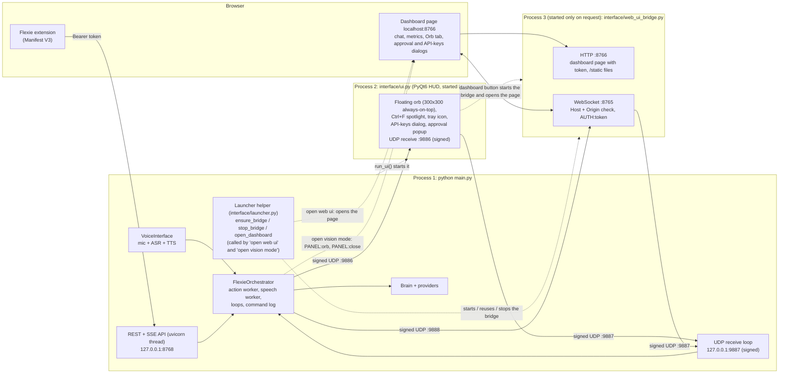

```mermaid
flowchart TB
    subgraph DB["SQLite databases (shared WAL connection per file)"]
        D1["data/telemetry.db<br/>LLM calls: tokens, cost, latency, failures"]
        D2["data/traces.db<br/>command traces and steps"]
        D3["data/memory_structured.db<br/>MemoryManager entries"]
        D4["flexie_memory.db, flexie_awareness.db,<br/>flexie_global_profile.db, clipboard_history.db"]
    end
    subgraph FILES["Files and folders"]
        F1["context/flexie_memory/<br/>Chroma vector store"]
        F2["workspace/.flexie_jobs/*.json<br/>build job state"]
        F3["flexie_activity.log, flexie_telemetry.log<br/>rotating logs"]
        F4[".flexie_udp_token, .flexie_ui_ports<br/>per-run auth and UI subscribers"]
        F5["browser_session/<br/>Playwright profile"]
        F6["automation_jobs.json, knowledge_index.json<br/>scheduler jobs, file index"]
        F7["Downloads/ job project folders<br/>Downloads/Flexie Images/"]
    end
    BRAINX["Brain + telemetry"] --> D1
    TRACEX["TraceCollector"] --> D2
    MEMX["MemoryManager / MemoryFacade"] --> D3
    ENGX["Memory, awareness, profile, clipboard engines"] --> D4
    VSX["VectorStore"] --> F1
    JOBX["JobManager"] --> F2
    LOGX["logging"] --> F3
    MAINX["main.py + udp_auth"] --> F4
    BRW["BrowserEngine"] --> F5
    SCHED["AutomationScheduler + KnowledgeEngine"] --> F6
    GENX["Build jobs + image downloader"] --> F7
```
<!--SPLIT-->
### 2.1 Startup (`main.py`)

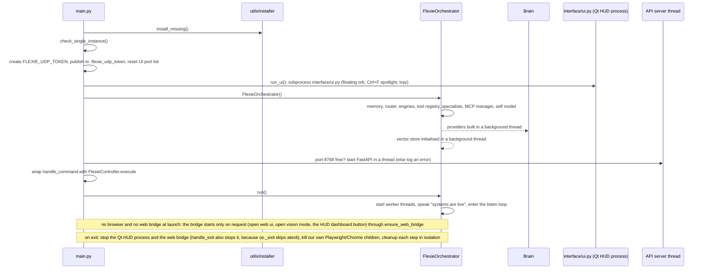

### 2.2 Threads and queues inside the orchestrator

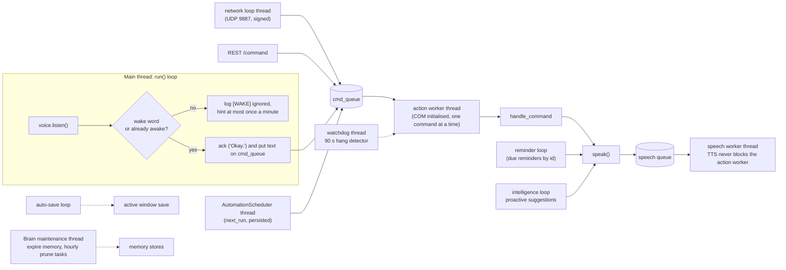

### 2.3 `handle_command` in detail

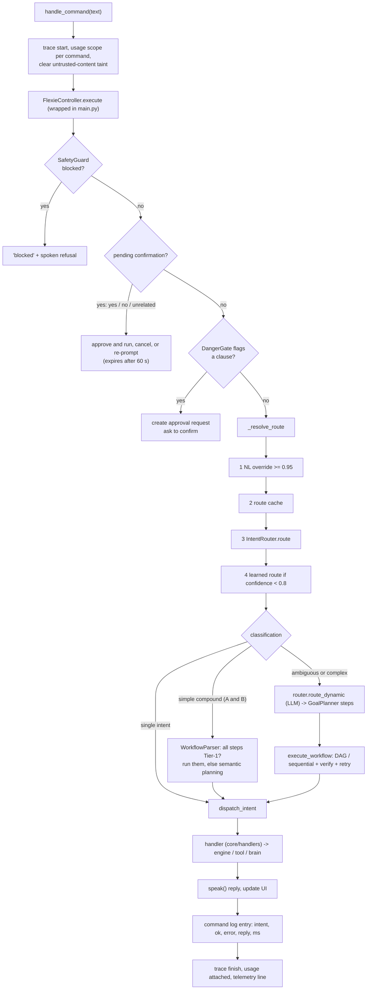

### 2.4 Voice in and out

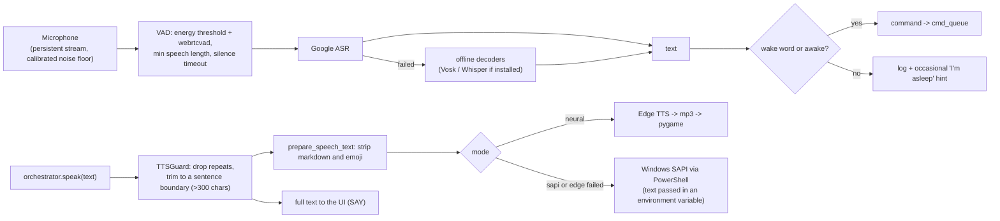

### 2.5 Tool execution and permissions

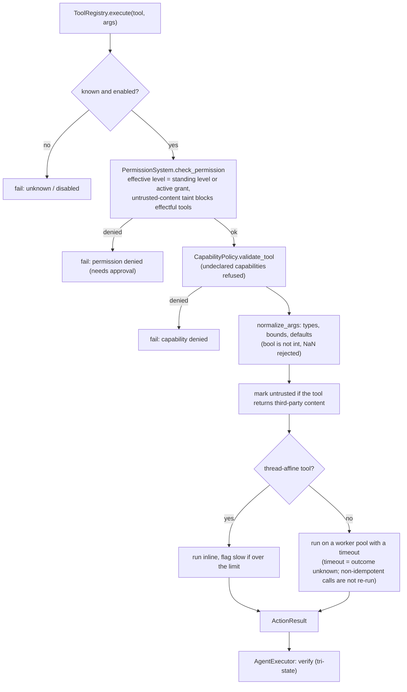

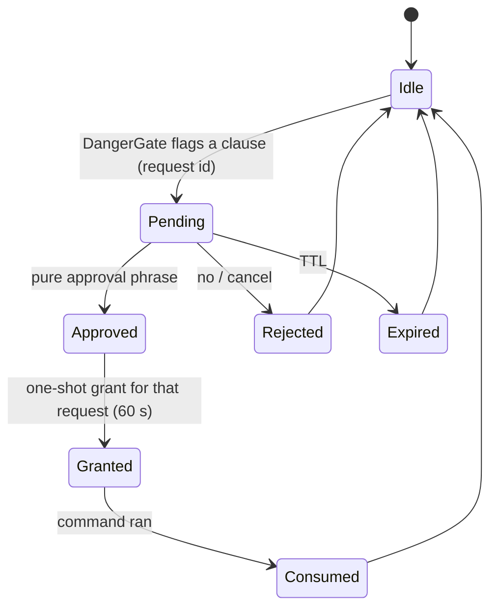

### 2.6 `Brain.ask`

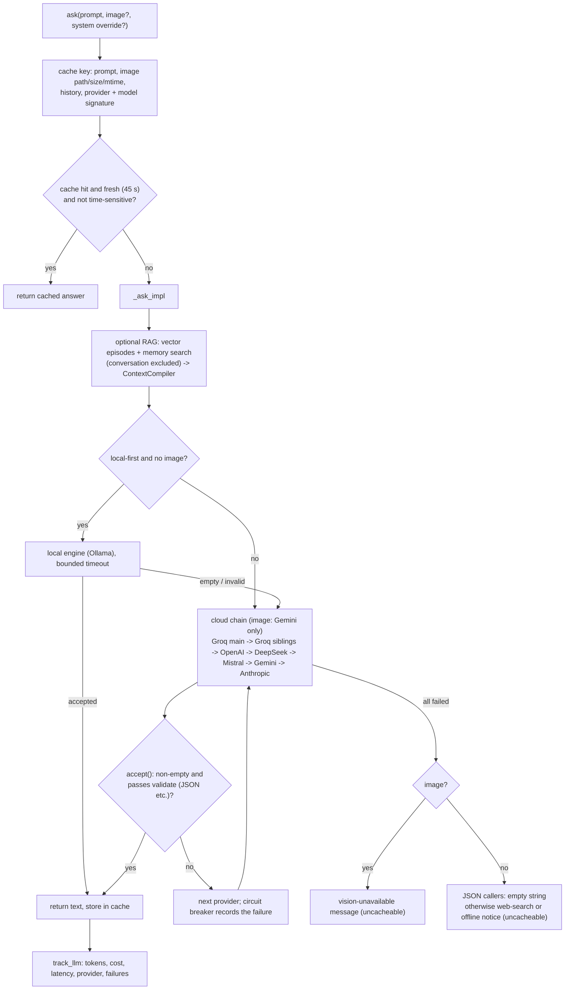

### 2.7 Memory: remember, recall, forget

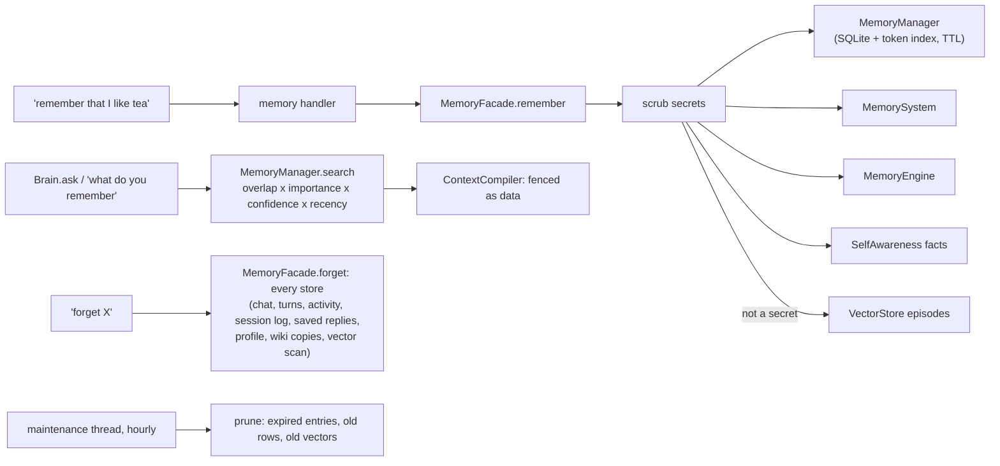

### 2.8 Autonomous build job

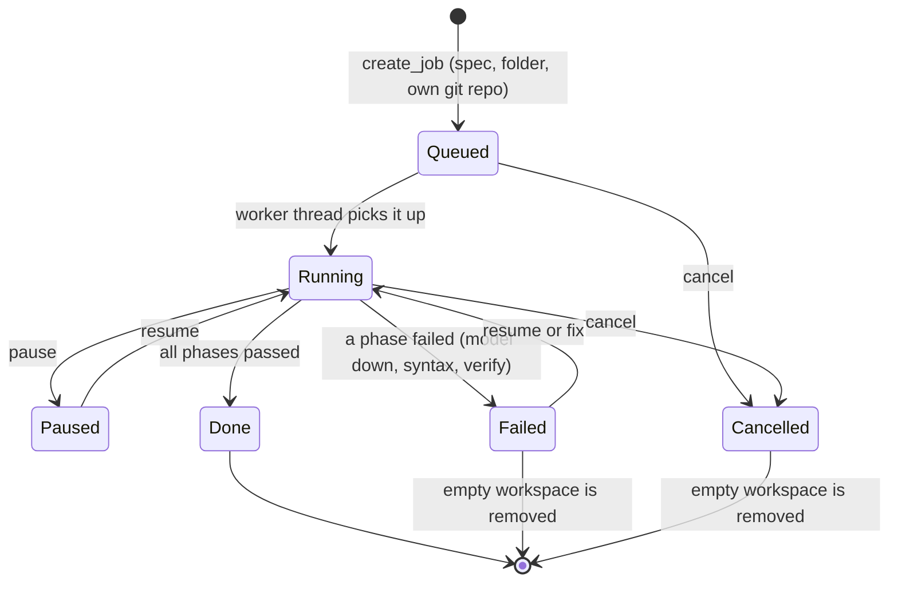

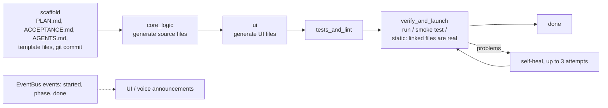

### 2.9 MCP servers

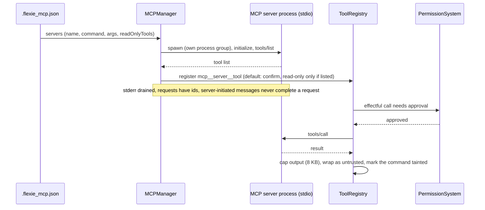

### 2.10 Planning and specialists

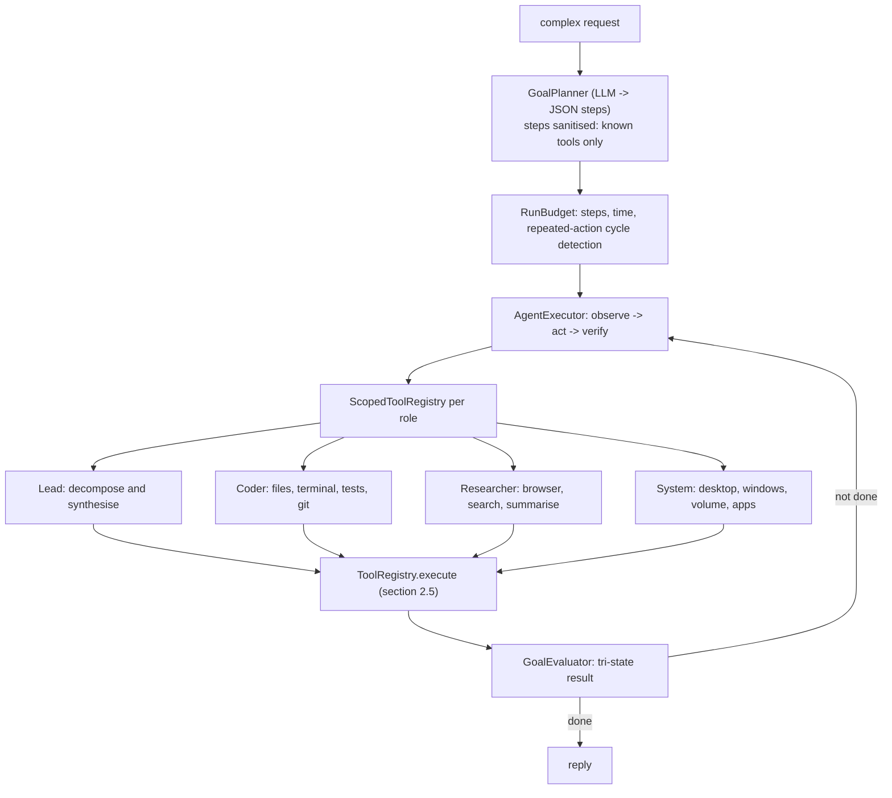

### 2.11 REST API and browser extension

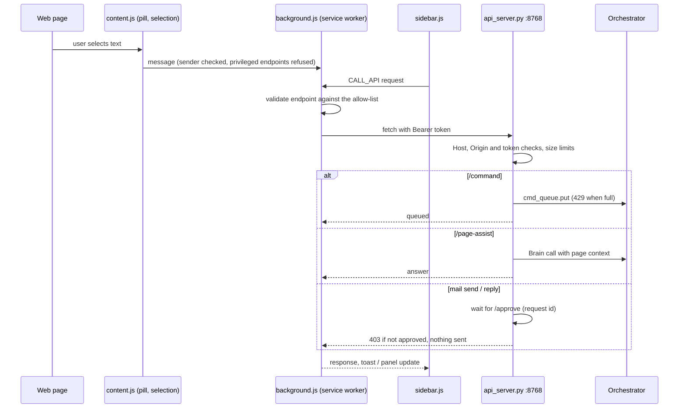

### 2.12 Telemetry, traces and events

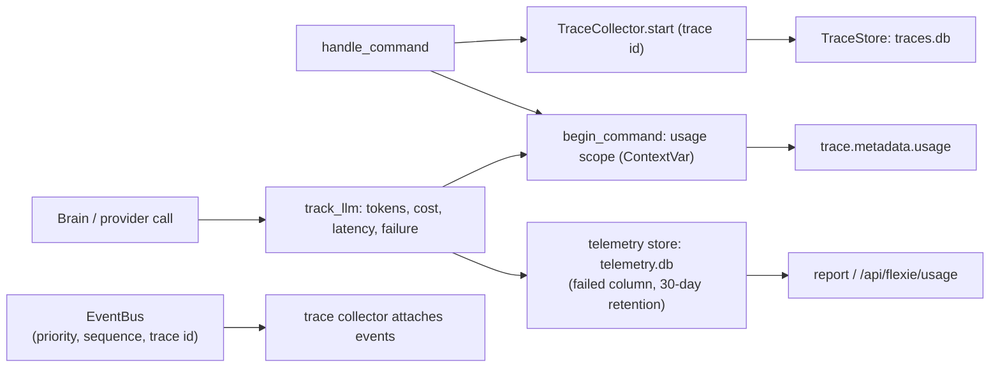

### 2.13 Screen, images and vision mode

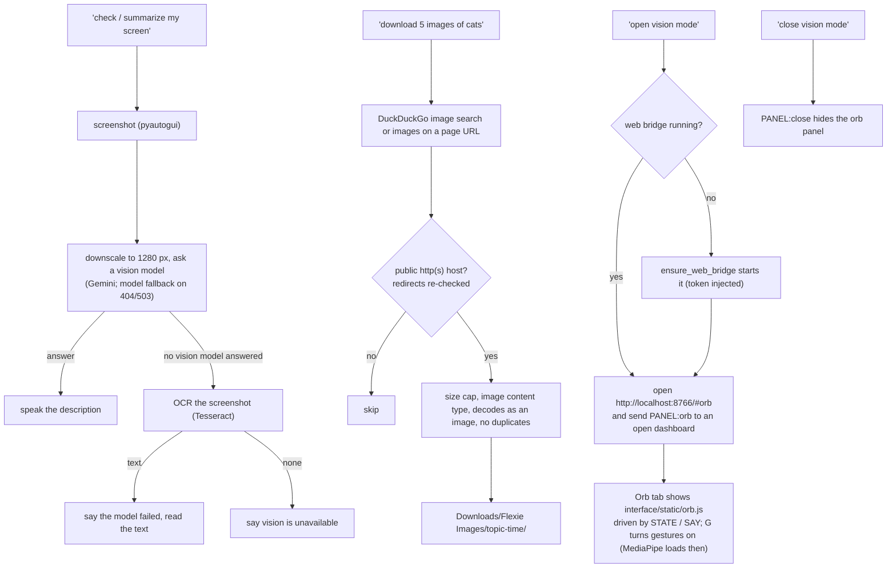

### 2.14 Tests, evals and CI

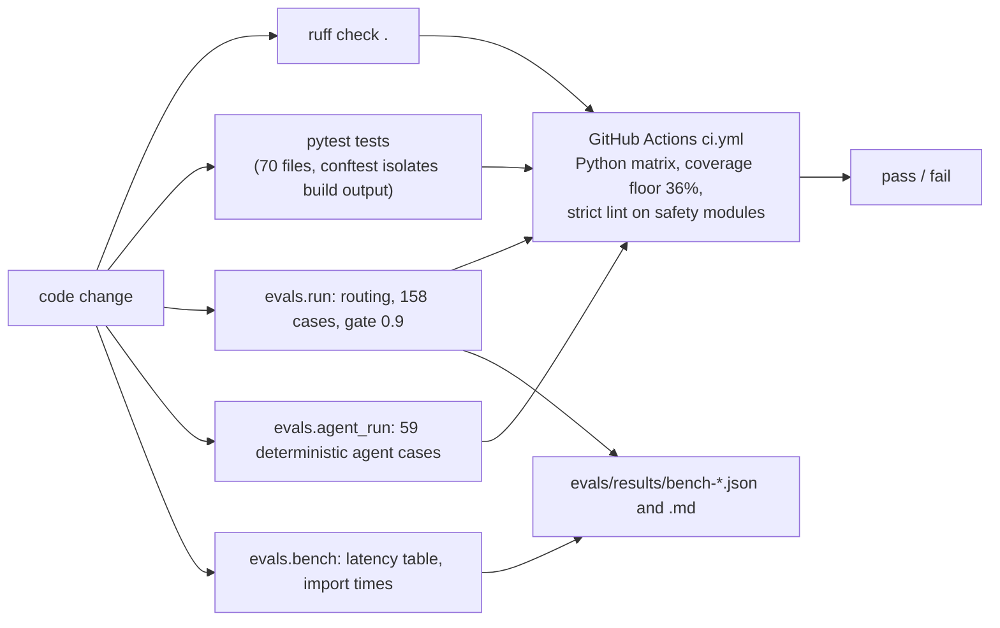
<!--SPLIT-->
### 4.1 Browser extension (`extension/`)

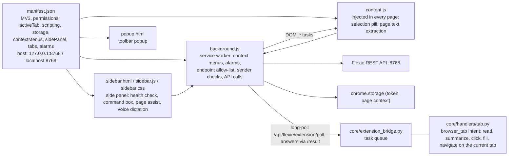

### 4.2 Web UI, orb and standalone web projects

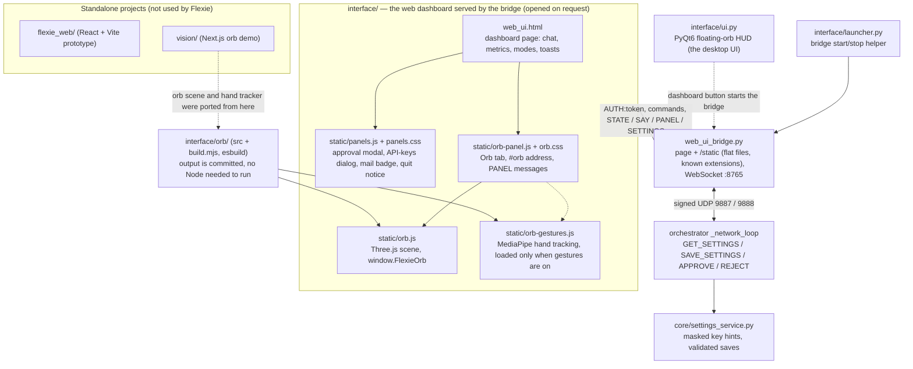

### 4.3 Templates, skills and data

```mermaid
flowchart LR
    subgraph TPL["templates/ (used by core/jobs)"]
        T1["static_site: index.html, script.js, style.css"]
        T2["flask_api: app.py, requirements.txt, test_app.py"]
        T3["react_vite: package.json, vite.config.js, src/"]
        T4["cli_tool: main.py, requirements.txt, test_cli.py"]
        TM["each has manifest.json (trigger words, files, run and test commands)"]
    end
    PL["core/jobs/planner.match_template"] --> TM
    SC["core/jobs/scaffold"] --> TPL

    subgraph SK["skills/"]
        K1["code-explainer/SKILL.md"]
        K2["research-and-summarize/SKILL.md"]
    end
    SL["core/skills loader + catalog<br/>(validated names, escaped, cached by mtime)"] --> SK
    SL --> SP["catalog appended to the system prompt"]

    subgraph PERS["data/persona/ (user-owned)"]
        PS1["SOUL.md, USER.md, MEMORY.md"]
    end
    PR["core/persona.py"] --> PERS
    PR --> SP
```
